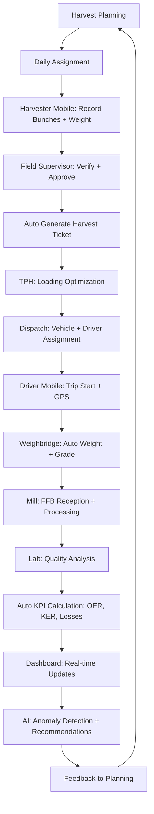
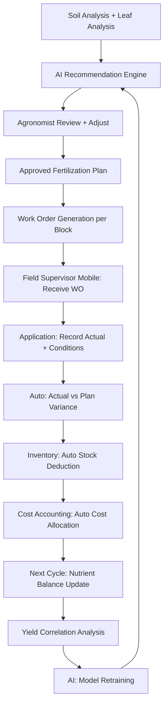
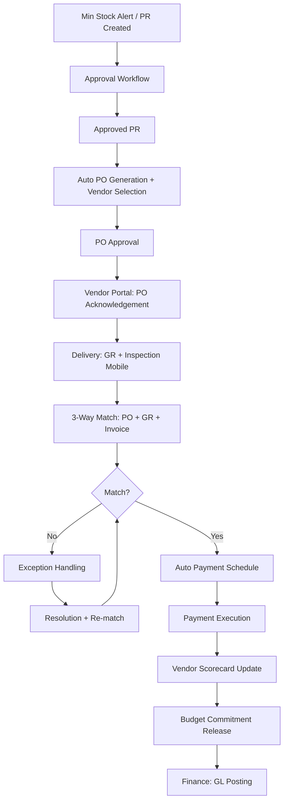

# Business Analysis Document
## AI-Powered Integrated Palm Oil Plantation Management Information System

**Version:** 1.0 (Template)
**Date:** 2025-01-15
**Phase:** 1 — Business Analysis
**Status:** Draft

---

## 1. Business Process Inventory

Based on the domain scope defined in Project Discovery, here is the complete process inventory organized by business domain.

### 1.1 Domain A: Corporate & Master Data Management

| Process ID | Process Name | Trigger | Input | Output | Owner | Frequency |
|------------|--------------|---------|-------|--------|-------|-----------|
| A.01 | Manage Company Profile | Setup / Change | Company legal data | Company master record | Corp Secretary | Rare |
| A.02 | Manage Estate Master | New estate / Reorg | Estate legal, GIS, area | Estate master record | Estate Manager | Rare |
| A.03 | Manage Afdeling Master | New afdeling / Reorg | Afdeling boundary, estate ref | Afdeling master record | Estate Manager | Rare |
| A.04 | Manage Block Master | New planting / Replant | Block geometry, variety, year | Block master record | Agronomy | Per planting |
| A.05 | Manage Sub-Block | Sub-division | Sub-block geometry, parent block | Sub-block record | Agronomy | As needed |
| A.06 | Manage Land Records | Acquisition / Legal change | Land docs, certificates, maps | Land register | Legal / Estate | Per transaction |
| A.07 | Manage Soil Data | Survey / Lab result | Soil samples, analysis | Soil profile per block | Agronomy | Periodic |
| A.08 | Manage Palm Variety | New variety approved | Variety specs, yield potential | Variety master | Agronomy / R&D | Rare |
| A.09 | Manage Planting Year Cohort | Annual planting | Planting plan, realization | Cohort tracking | Agronomy | Annual |
| A.10 | Manage Tree Population | Census / Update | Block, count, condition | Population register | Agronomy | Annual / Event |
| A.11 | Manage Organization Structure | Reorg / New dept | Org chart, hierarchy | Org master | HR / GM | Rare |
| A.12 | Manage Department | Reorg | Dept info, parent org | Department master | HR | Rare |
| A.13 | Manage Employee | Hire / Transfer / Exit | Employee data, position, estate | Employee master | HR | Event-driven |
| A.14 | Manage Position & Grade | Org design | Position desc, grade, salary band | Position master | HR | Rare |
| A.15 | Manage Vendor | New vendor / Renewal | Vendor docs, categories, terms | Vendor master | Procurement | Event-driven |
| A.16 | Manage Customer | New contract | Customer info, terms, pricing | Customer master | Sales | Event-driven |
| A.17 | Manage Material Master | New item / Spec change | Material specs, UOM, category | Material master | Procurement / Warehouse | Event-driven |
| A.18 | Manage Equipment Master | New asset / Disposal | Asset specs, location, owner | Equipment master | Maintenance | Event-driven |
| A.19 | Manage Vehicle Master | New vehicle / Disposal | Vehicle specs, plate, capacity | Vehicle master | Transport | Event-driven |
| A.20 | Manage Warehouse | New location / Reorg | Warehouse info, type, capacity | Warehouse master | Warehouse | Rare |
| A.21 | Manage Cost Center | Budget setup | CC code, name, owner, budget | Cost center master | Finance | Annual |
| A.22 | Manage Budget | Annual planning | Budget items, amounts, CC | Budget register | Finance | Annual |
| A.23 | Manage User & Access | Hire / Role change | User, roles, permissions, org | User account | IT / Security | Event-driven |
| A.24 | Manage Role & Permission | New feature / Policy | Role def, permissions | RBAC config | IT / Security | Rare |

### 1.2 Domain B: Land Management

| Process ID | Process Name | Trigger | Input | Output | Owner | Frequency |
|------------|--------------|---------|-------|--------|-------|-----------|
| B.01 | Land Acquisition | Expansion | Legal docs, negotiation, payment | Land title, HGU application | Legal / GM | Project-based |
| B.02 | Land Legality Management | Renewal / Audit | Permits, certificates, deadlines | Compliance register | Legal | Ongoing |
| B.03 | Land Mapping & GIS | Survey / Update | GPS survey, drone, satellite | GIS layers, boundaries | GIS Team | Periodic |
| B.04 | Land Boundary Management | Dispute / Re-survey | Boundary markers, neighbor agreement | Boundary records | Estate / Legal | Event-driven |
| B.05 | Land Preparation | New planting | Clearing plan, budget, contractor | Prepared land ready | Estate / Contractor | Per project |
| B.06 | Clearing Operations | Land prep start | Area, method, timeline | Clearing progress, cost | Estate | Per project |
| B.07 | Road Construction | Infrastructure plan | Design, BOQ, contractor | Road assets, cost | Engineering | Per project |
| B.08 | Drainage Construction | Water mgmt plan | Design, BOQ, contractor | Drainage assets, cost | Engineering | Per project |
| B.09 | Land Zoning | Planning | Land use plan, regulations | Zoning map | Planning | Periodic |
| B.10 | Land Classification | Survey | Soil, topography, legal | Classification register | Agronomy / Legal | Periodic |
| B.11 | Replanting Planning | Age / Yield decline | Block age, yield trend, budget | Replanting schedule | Agronomy / Finance | Annual |
| B.12 | Land History Tracking | Any land event | Transaction, legal, operational | Land history log | Legal / Estate | Continuous |

### 1.3 Domain C: Nursery Management

| Process ID | Process Name | Trigger | Input | Output | Owner | Frequency |
|------------|--------------|---------|-------|--------|-------|-----------|
| C.01 | Seed Procurement | Planting plan | Variety, quantity, budget | Purchase order, delivery | Procurement / Agronomy | Per season |
| C.02 | Germination Management | Seed received | Seeds, media, conditions | Germination rate, culls | Nursery Manager | Per batch |
| C.03 | Pre-Nursery Management | Germinated seeds | Seedlings, media, shade, water | Pre-nursery stock | Nursery Manager | 3-4 months |
| C.04 | Main Nursery Management | Pre-nursery ready | Seedlings, polybags, fertilizer | Main nursery stock | Nursery Manager | 8-12 months |
| C.05 | Seedling Monitoring | Daily | Growth params, pests, diseases | Monitoring records | Nursery Staff | Daily |
| C.06 | Nursery Fertilization | Schedule / Deficiency | Fertilizer plan, stock | Application records | Nursery Manager | Weekly |
| C.07 | Pest & Disease Monitoring | Daily / Trap | Scouting, traps, symptoms | Pest/disease records | Nursery Staff | Daily |
| C.08 | Seedling Grading | Pre-distribution | Height, girth, leaf count, roots | Grade A/B/C, reject | Nursery Manager | Per distribution |
| C.09 | Seedling Distribution | Planting request | Graded seedlings, transport | Delivery note, receipt | Nursery / Estate | Per planting |
| C.10 | Seedling Inventory | Daily / Monthly | Receipts, issues, mortality | Stock balance | Nursery Manager | Daily |
| C.11 | Seedling Mortality Tracking | Death event | Cause, count, batch | Mortality report | Nursery Manager | Event-driven |
| C.12 | Nursery Cost Analysis | Monthly / Season | All costs, output qty | Cost per seedling | Finance / Nursery | Monthly |

### 1.4 Domain D: Planting & Replanting

| Process ID | Process Name | Trigger | Input | Output | Owner | Frequency |
|------------|--------------|---------|-------|--------|-------|-----------|
| D.01 | Planting Planning | Annual / Replant | Land ready, variety, budget | Planting plan, schedule | Agronomy / Estate | Annual |
| D.02 | Planting Execution | Plan approved | Seedlings, labor, tools, layout | Planting realization | Estate / Agronomy | Per event |
| D.03 | Planting Date Recording | Each block planted | Block, date, variety, density | Planting register | Field Supervisor | Per block |
| D.04 | Planting Variety Tracking | Planting | Variety per block | Variety map | Agronomy | Per block |
| D.05 | Plant Population Management | Census / Missing | Count, spacing, vacants | Population register | Agronomy | Annual |
| D.06 | Spacing Compliance | Planting / Audit | Design vs actual | Compliance report | Agronomy | Per planting |
| D.07 | Missing Plants Replacement | Census / Survey | Vacant points, seedlings | Replacement record | Field Supervisor | As needed |
| D.08 | Growth Monitoring (TBM) | Monthly | Height, girth, frond count | Growth curves | Agronomy | Monthly |
| D.09 | Growth Monitoring (TM) | Monthly | Height, girth, frond count | Growth curves | Agronomy | Monthly |
| D.10 | Replanting Management | Decision approved | Old block, new variety, budget | Replanting execution | Estate / Agronomy | Per project |

### 1.5 Domain E: Agronomy & Plantation Maintenance

| Process ID | Process Name | Trigger | Input | Output | Owner | Frequency |
|------------|--------------|---------|-------|--------|-------|-----------|
| E.01 | Fertilization Planning | Annual / Soil analysis | Soil data, leaf analysis, yield target | Fertilizer recommendation | Agronomy | Annual |
| E.02 | Fertilizer Application | Schedule / Order | Plan, fertilizer stock, labor | Application record | Field Supervisor | Per round |
| E.03 | Fertilization Monitoring | Post-application | Application record, weather | Compliance, efficiency | Agronomy | Per round |
| E.04 | Weed Control Planning | Schedule / Survey | Weed survey, method, chemical | Weed control plan | Agronomy | Per cycle |
| E.05 | Weed Control Execution | Plan / Spot | Herbicide, labor, equipment | Application record | Field Supervisor | Per cycle |
| E.06 | Pest Control Monitoring | Trap / Scout | Trap counts, scouting | Pest population trend | Agronomy | Weekly |
| E.07 | Pest Control Execution | Threshold exceeded | Pesticide, method, area | Application record | Field Supervisor | Event-driven |
| E.08 | Disease Control Monitoring | Scout / Lab | Symptoms, lab confirmation | Disease incidence | Agronomy | Weekly |
| E.09 | Disease Control Execution | Outbreak | Fungicide, method, area | Application record | Field Supervisor | Event-driven |
| E.10 | Pruning Management | Schedule / Age | Block age, frond count | Pruning record | Field Supervisor | Per round |
| E.11 | Drainage Maintenance | Schedule / Rain | Drain condition, silt level | Maintenance record | Engineering | Periodic |
| E.12 | Soil Management | Annual / Issue | Soil analysis, compaction, pH | Soil improvement plan | Agronomy | Annual |
| E.13 | Water Management | Seasonal | Rainfall, water table, demand | Irrigation/drainage ops | Engineering | Daily/Seasonal |
| E.14 | Field Inspection Planning | Schedule | Block priority, inspector | Inspection schedule | Agronomy | Weekly |
| E.15 | Field Inspection Execution | Schedule | Checklist, observations | Inspection report | Inspector | Per visit |
| E.16 | Work Verification | Post-work | Work order, standards | Verification record | Supervisor / Agronomy | Per work order |
| E.17 | Agronomic Recommendation | Analysis / AI | Data, rules, models | Recommendation | Agronomy / AI | Continuous |

### 1.6 Domain F: Harvest Management

| Process ID | Process Name | Trigger | Input | Output | Owner | Frequency |
|------------|--------------|---------|-------|--------|-------|-----------|
| F.01 | Harvest Planning | Monthly / Seasonal | Block maturity, labor, target | Harvest schedule | Estate Manager | Monthly |
| F.02 | Harvest Rotation | Schedule | Block sequence, interval | Rotation plan | Estate Manager | Continuous |
| F.03 | Harvest Schedule (Daily) | Daily | Rotation, labor, weather | Daily assignment | Field Supervisor | Daily |
| F.04 | Harvest Assignment | Daily schedule | Harvester, block, quota | Assignment slip | Field Supervisor | Daily |
| F.05 | Harvester Management | Hire / Performance | Harvester data, productivity | Harvester register | HR / Estate | Ongoing |
| F.06 | Harvest Productivity Tracking | Daily | Bunches, weight, hours, area | Productivity records | Field Supervisor | Daily |
| F.07 | Harvest Recording (FFB/TBS) | Each harvest | Block, harvester, weight, grade | Harvest ticket | Field Supervisor | Daily |
| F.08 | Loose Fruit Recording | Each harvest | Block, weight, collector | Loose fruit record | Field Supervisor | Daily |
| F.09 | Harvest Quality Assessment | Each load | Ripeness, bruising, contamination | Quality grade | Grader / Mill | Per load |
| F.10 | Harvest Losses Measurement | Sample / Survey | Unharvested, loose, rotten | Loss quantification | Agronomy | Periodic |
| F.11 | Restan Management | Each round | Unharvested bunches, reason | Restan record | Field Supervisor | Per round |
| F.12 | Harvest Target Setting | Annual / Monthly | Historical, age, variety | Target per block/afdeling | Estate Manager | Monthly |
| F.13 | Harvest Premium Calculation | Payroll period | Productivity, quality, attendance | Premium amount | HR / Finance | Monthly |
| F.14 | Harvest Cost Analysis | Monthly | Labor, tools, transport, overhead | Cost per ton FFB | Finance | Monthly |

### 1.7 Domain G: Transportation & Logistics

| Process ID | Process Name | Trigger | Input | Output | Owner | Frequency |
|------------|--------------|---------|-------|--------|-------|-----------|
| G.01 | Transport Planning | Daily / Harvest | FFB volume, vehicle availability | Transport schedule | Transport Manager | Daily |
| G.02 | TPH (Tempat Penimbunan Hasil) Management | Harvest | Location, capacity, schedule | TPH register | Transport / Field | Daily |
| G.03 | Loading Operations | Scheduled trip | FFB at TPH, loader, vehicle | Loading record | Loader Operator | Per trip |
| G.04 | Vehicle Management | Acquisition / Maintenance | Vehicle specs, docs, maintenance | Vehicle register | Transport Manager | Ongoing |
| G.05 | Driver Management | Hire / Schedule | Driver license, medical, roster | Driver register | Transport / HR | Ongoing |
| G.06 | Transport Scheduling | Daily plan | Trips, vehicles, drivers, routes | Dispatch schedule | Transport Manager | Daily |
| G.07 | Trip Recording | Each trip | GPS, weighbridge, times | Trip log | Driver / System | Per trip |
| G.08 | Tonnage Tracking | Weighbridge | Gross, tare, net per trip | Tonnage register | Weighbridge / System | Per trip |
| G.09 | Fuel Management | Refuel / Trip | Fuel issued, consumption | Fuel log | Transport Manager | Per trip |
| G.10 | Travel Time Monitoring | Trip | Departure, arrival, delays | Time analysis | Transport Manager | Per trip |
| G.11 | Road Condition Reporting | Inspection / Report | Road segment, condition | Road condition log | Engineering | Weekly |
| G.12 | Mill Delivery Coordination | Arrival | Mill schedule, queue, quality | Delivery receipt | Transport / Mill | Per trip |
| G.13 | Transport Vendor Management | Contract / Spot | Vendor, rate, performance | Vendor contract | Procurement / Transport | Ongoing |
| G.14 | Transport Cost Analysis | Monthly | Fuel, maintenance, labor, vendor | Cost per ton-km | Finance / Transport | Monthly |
| G.15 | Vehicle Utilization Analysis | Monthly | Operating hours, trips, downtime | Utilization report | Transport Manager | Monthly |

### 1.8 Domain H: Palm Oil Mill Management

| Process ID | Process Name | Trigger | Input | Output | Owner | Frequency |
|------------|--------------|---------|-------|--------|-------|-----------|
| H.01 | Weighbridge Operations | Truck arrival | Truck ID, ticket, weight | Weighbridge ticket | Weighbridge Operator | Per truck |
| H.02 | Incoming FFB Grading | Weighbridge | Sample, visual, lab | Grade, deduction | Grader / Lab | Per truck |
| H.03 | FFB Sorting | Grading result | Grade, destination | Sorted FFB | Mill Operator | Continuous |
| H.04 | Sterilization | Process start | FFB, steam, time | Sterilized bunches | Mill Operator | Continuous |
| H.05 | Threshing | Sterilized bunches | Machine, speed | Loose fruit, empty bunches | Mill Operator | Continuous |
| H.06 | Digestion & Pressing | Threshed fruit | Pressure, temperature | Crude oil, press cake | Mill Operator | Continuous |
| H.07 | Clarification | Crude oil | Heat, vibration, centrifuge | Clean CPO, sludge | Mill Operator | Continuous |
| H.08 | Kernel Recovery | Press cake | Nut cracking, separation | Kernel, shell | Mill Operator | Continuous |
| H.09 | CPO Production Recording | Continuous | Flow meter, tank gauge | Production log | Mill Operator | Continuous |
| H.10 | Kernel Production Recording | Continuous | Weight, moisture | Production log | Mill Operator | Continuous |
| H.11 | Rendement Calculation | Shift / Daily | CPO + Kernel / FFB input | OER, KER, extraction rates | Lab / Mill Manager | Per shift |
| H.12 | Oil Losses Tracking | Process | Sterilizer condensate, sludge, effluent | Loss accounting | Lab / Mill Manager | Daily |
| H.13 | Kernel Losses Tracking | Process | Uncracked, shell contamination | Loss accounting | Lab / Mill Manager | Daily |
| H.14 | Throughput Monitoring | Continuous | FFB processed per hour | Throughput rate | Mill Operator | Continuous |
| H.15 | Mill Downtime Recording | Breakdown / Plan | Reason, duration, equipment | Downtime log | Maintenance | Per event |
| H.16 | Mill Maintenance | Schedule / Breakdown | Work order, parts, labor | Maintenance record | Maintenance | Per event |
| H.17 | Laboratory Analysis | Sample / Schedule | FFB, CPO, Kernel, POME | Quality parameters | Lab | Per sample |
| H.18 | Quality Control | Continuous | Specs, test results | QC report, hold/release | Lab / QA | Continuous |
| H.19 | Waste Management (POME) | Continuous | Effluent volume, BOD/COD | Treatment record | Environmental | Continuous |
| H.20 | Waste Management (EFB) | Continuous | EFB volume, utilization | Disposal/utilization record | Environmental | Continuous |
| H.21 | Production Inventory | Continuous | Production, dispatch, tank stock | Inventory balance | Mill Manager | Continuous |
| H.22 | Mill Performance Reporting | Daily / Monthly | All KPIs | Performance report | Mill Manager | Daily/Monthly |

### 1.9 Domain I: Inventory & Warehouse Management

| Process ID | Process Name | Trigger | Input | Output | Owner | Frequency |
|------------|--------------|---------|-------|--------|-------|-----------|
| I.01 | Warehouse Setup | New location | Location, type, capacity, bins | Warehouse master | Warehouse Manager | Rare |
| I.02 | Goods Receipt (GR) | PO / Transfer / Production | Delivery note, PO, inspection | GR note, stock increase | Warehouse Staff | Per delivery |
| I.03 | Goods Issue (GI) | PR / Work order / Transfer | Request, approval, picking | GI note, stock decrease | Warehouse Staff | Per request |
| I.04 | Stock Transfer | Inter-warehouse | Transfer order, approval | Transfer record | Warehouse Staff | Per transfer |
| I.05 | Stock Opname (Physical Count) | Schedule / Audit | Count sheets, system balance | Opname report, adjustment | Warehouse / Finance | Periodic |
| I.06 | Stock Adjustment | Discrepancy / Damage / Expiry | Reason, approval | Adjustment journal | Warehouse / Finance | Event-driven |
| I.07 | Minimum Stock Monitoring | Daily / Reorder | Min level, current stock | Reorder alert | Warehouse System | Daily |
| I.08 | Maximum Stock Control | Receipt planning | Max level, incoming | Receipt hold/redirect | Warehouse Manager | Per receipt |
| I.09 | Safety Stock Calculation | Annual / Demand change | Lead time, demand variability | Safety stock level | Procurement / Warehouse | Annual |
| I.10 | Dead Stock Identification | Aging report | No movement > 12 months | Dead stock list | Warehouse / Finance | Quarterly |
| I.11 | Slow-Moving Stock Analysis | Aging report | Low turnover items | Slow-moving list | Warehouse / Procurement | Quarterly |
| I.12 | Fertilizer Inventory Management | Seasonal | Plan, receipt, issue, balance | Fertilizer stock report | Warehouse / Agronomy | Daily |
| I.13 | Pesticide Inventory Management | Seasonal | Plan, receipt, issue, balance | Pesticide stock report | Warehouse / Agronomy | Daily |
| I.14 | Spare Parts Inventory | Maintenance | BOM, criticality, usage | Spare parts stock | Maintenance / Warehouse | Daily |
| I.15 | Fuel Inventory | Daily | Receipt, issue, tank gauge | Fuel stock report | Transport / Warehouse | Daily |
| I.16 | Tools & Equipment Inventory | Issue / Return | Tool register, condition | Tool tracking | Warehouse / Users | Per transaction |

### 1.10 Domain J: Procurement Management

| Process ID | Process Name | Trigger | Input | Output | Owner | Frequency |
|------------|--------------|---------|-------|--------|-------|-----------|
| J.01 | Purchase Requisition (PR) | Need identified | Requestor, item, qty, spec, budget | PR document | Requestor | Event-driven |
| J.02 | PR Approval | PR submitted | Approval matrix, budget check | Approved/Rejected PR | Approvers | Per PR |
| J.03 | Purchase Order (PO) Creation | Approved PR | Vendor, terms, price, delivery | PO document | Procurement | Per PR |
| J.04 | PO Approval | PO created | Approval matrix, budget | Approved PO | Approvers | Per PO |
| J.05 | Vendor Management | New / Evaluation | Vendor docs, performance, compliance | Vendor register | Procurement | Ongoing |
| J.06 | Procurement Planning | Annual / Project | Budget, forecast, contracts | Procurement plan | Procurement / Finance | Annual |
| J.07 | Goods Receipt & Inspection | Delivery | PO, delivery note, inspection | GR + Inspection report | Warehouse / QC | Per delivery |
| J.08 | Invoice Matching (3-Way) | Invoice received | PO, GR, Invoice | Matched/Discrepancy | Finance / Procurement | Per invoice |
| J.09 | Procurement Budget Control | Commitment / Payment | Budget, commitments, actuals | Budget utilization | Finance / Procurement | Real-time |
| J.10 | Supplier Evaluation | Periodic / Event | Quality, delivery, price, service | Scorecard, rating | Procurement | Quarterly |
| J.11 | Procurement History | All transactions | PO, GR, Invoice, Payment | Audit trail | Procurement / Finance | Continuous |

### 1.11 Domain K: Human Resource Management

| Process ID | Process Name | Trigger | Input | Output | Owner | Frequency |
|------------|--------------|---------|-------|--------|-------|-----------|
| K.01 | Employee Onboarding | New hire | Personal data, contract, docs | Employee record | HR | Per hire |
| K.02 | Organization Management | Reorg | Structure, positions, reporting | Org chart | HR / Management | Event-driven |
| K.03 | Recruitment | Vacancy | Job desc, req, candidates | Hire/Reject | HR / Hiring Manager | Per vacancy |
| K.04 | Placement & Transfer | Need / Request | Employee, new position, location | Transfer order | HR / Manager | Event-driven |
| K.05 | Attendance Recording | Daily | Clock-in/out, shift, location | Attendance log | System / Supervisor | Daily |
| K.06 | Work Assignment | Daily / Task | Employee, task, location, target | Assignment record | Supervisor | Daily |
| K.07 | Productivity Tracking | Daily | Output, hours, standard | Productivity record | Supervisor / System | Daily |
| K.08 | Performance Appraisal | Periodic | KPI, behavior, achievements | Appraisal record | Manager / HR | Semi-annual |
| K.09 | Leave Management | Request | Employee, type, dates, balance | Leave record | HR / Manager | Event-driven |
| K.10 | Overtime Management | Work beyond shift | Hours, reason, approval | OT record | Supervisor / HR | Event-driven |
| K.11 | Payroll Processing | Pay period | Attendance, productivity, rates, deductions | Payslip, payment | Finance / HR | Monthly |
| K.12 | Incentive & Premium Calculation | Pay period | Productivity, quality, attendance | Incentive amount | HR / Finance | Monthly |
| K.13 | Training Management | Need / Plan | Employee, course, provider | Training record | HR | Event-driven |
| K.14 | Competency Management | Assessment / Role | Skills, certifications, gaps | Competency matrix | HR / Manager | Periodic |
| K.15 | K3 (Occupational Health & Safety) | Incident / Audit | Hazard, incident, inspection | K3 register, actions | K3 Officer | Continuous |

### 1.12 Domain L: Finance & Accounting

| Process ID | Process Name | Trigger | Input | Output | Owner | Frequency |
|------------|--------------|---------|-------|--------|-------|-----------|
| L.01 | Budget Planning | Annual | Strategic plan, historical, assumptions | Budget document | Finance / Dept Heads | Annual |
| L.02 | Cost Center Management | Setup / Change | CC structure, owner, budget | CC master | Finance | Rare |
| L.03 | Expense Recording | Transaction | Invoice, receipt, allocation | Expense journal | Finance | Daily |
| L.04 | Revenue Recording | Sales / Production | Invoice, weighbridge, contract | Revenue journal | Finance | Daily |
| L.05 | Cash Flow Management | Daily | Receipts, payments, forecast | Cash position | Finance | Daily |
| L.06 | Accounts Payable | Invoice due | Invoice, approval, payment terms | AP aging, payment | Finance | Daily |
| L.07 | Accounts Receivable | Invoice issued | Invoice, payment terms, collection | AR aging, collection | Finance | Daily |
| L.08 | General Ledger | All transactions | Journals, chart of accounts | GL, Trial Balance | Finance | Continuous |
| L.09 | Cost Accounting | Production / Activity | Cost pools, drivers, allocation | Cost per unit | Finance | Monthly |
| L.10 | Operational Cost Tracking | Monthly | All cost centers, categories | Cost report | Finance | Monthly |
| L.11 | Cost per Hectare Calculation | Monthly | Total cost, mature area | Cost/ha | Finance / Agronomy | Monthly |
| L.12 | Cost per kg TBS Calculation | Monthly | Total harvest cost, FFB produced | Cost/kg TBS | Finance / Estate | Monthly |
| L.13 | Cost per kg CPO Calculation | Monthly | Total mill cost, CPO produced | Cost/kg CPO | Finance / Mill | Monthly |
| L.14 | Profitability Analysis | Monthly | Revenue, cost by segment | Profitability report | Finance | Monthly |
| L.15 | Financial Reporting | Monthly / Quarterly / Annual | GL, sub-ledgers, notes | Financial statements | Finance | Periodic |

### 1.13 Domain M: Sales & Downstream

| Process ID | Process Name | Trigger | Input | Output | Owner | Frequency |
|------------|--------------|---------|-------|--------|-------|-----------|
| M.01 | Customer Management | New / Renewal | Customer data, contract, terms | Customer master | Sales | Event-driven |
| M.02 | Sales Contract | Negotiation | Terms, price, volume, period | Contract document | Sales / Legal | Per contract |
| M.03 | Sales Order | Contract / Spot | Customer, product, qty, delivery | Sales order | Sales | Per order |
| M.04 | Pricing Management | Market / Contract | Market price, premium/discount, terms | Price list | Sales / Finance | Periodic |
| M.05 | CPO Sales Execution | Order / Schedule | Order, tank allocation, shipping | Delivery order | Sales / Mill | Per shipment |
| M.06 | Kernel Sales Execution | Order / Schedule | Order, warehouse allocation, shipping | Delivery order | Sales / Warehouse | Per shipment |
| M.07 | Sales Inventory | Production / Sales | Production, dispatch, stock | Inventory balance | Sales / Mill / Warehouse | Continuous |
| M.08 | Delivery Management | Shipping | DO, vessel/truck, documents | Delivery record | Logistics / Sales | Per shipment |
| M.09 | Shipping Documentation | Shipment | Bill of lading, COA, phytosanitary | Shipping docs | Logistics / Sales | Per shipment |
| M.10 | Sales Invoicing | Delivery confirmed | DO, price, terms | Sales invoice | Finance / Sales | Per shipment |
| M.11 | Payment Collection | Invoice due | Invoice, payment terms | Payment receipt | Finance | Per payment |
| M.12 | Receivables Management | Aging | Outstanding, collection efforts | Collection report | Finance / Sales | Weekly |
| M.13 | Customer Profitability | Periodic | Revenue, cost, payment behavior | Profitability per customer | Finance / Sales | Monthly |

### 1.14 Domain N: Governance, Sustainability & Compliance

| Process ID | Process Name | Trigger | Input | Output | Owner | Frequency |
|------------|--------------|---------|-------|--------|-------|-----------|
| N.01 | Legal Compliance Tracking | Regulation change / Audit | Laws, permits, deadlines | Compliance register | Legal | Continuous |
| N.02 | ISPO Certification Management | Audit / Renewal | Standards, evidence, audit | Certification status | Sustainability | Annual |
| N.03 | RSPO Certification (if applicable) | Audit / Renewal | Standards, evidence, audit | Certification status | Sustainability | Annual |
| N.04 | Environmental Management | Operation / Incident | Impact, mitigation, monitoring | Environmental register | Environmental | Continuous |
| N.05 | Waste Management Compliance | Generation / Disposal | Waste type, volume, method | Waste manifest | Environmental | Per disposal |
| N.06 | Traceability (FFB to Block) | Audit / Buyer request | Harvest, transport, mill records | Traceability report | Sustainability / Mill | On demand |
| N.07 | Occupational Safety (K3) | Incident / Inspection | Hazard, incident, inspection | K3 register, actions | K3 Officer | Continuous |
| N.08 | Audit Management | Schedule / Request | Audit plan, criteria, evidence | Audit report, findings | Internal Audit | Per audit |
| N.09 | Risk Management | Annual / Event | Risk identification, assessment | Risk register, mitigation | Risk Officer | Quarterly |
| N.10 | Sustainability Reporting | Annual / Framework | GRI, ISPO, RSPO, internal | Sustainability report | Sustainability | Annual |

### 1.15 Domain O: Business Intelligence & Reporting

| Process ID | Process Name | Trigger | Input | Output | Owner | Frequency |
|------------|--------------|---------|-------|--------|-------|-----------|
| O.01 | Operational Dashboard | Real-time | Live data feeds | Dashboard | BI / IT | Real-time |
| O.02 | Management Dashboard | Daily / Weekly | Aggregated KPIs | Executive dashboard | BI | Daily |
| O.03 | Production Report | Daily / Monthly | Harvest, mill, transport | Production report | BI / Operations | Daily/Monthly |
| O.04 | Productivity Report | Monthly | Labor, machine, land | Productivity analysis | BI / Operations | Monthly |
| O.05 | Cost Report | Monthly | All cost centers | Cost analysis | BI / Finance | Monthly |
| O.06 | Financial Report | Monthly / Quarterly | GL, sub-ledgers | Financial statements | BI / Finance | Periodic |
| O.07 | KPI Monitoring | Real-time / Daily | KPI definitions, thresholds | KPI scorecard | BI / All Managers | Real-time |
| O.08 | Drill-Down Analysis | Ad-hoc | Transactional data | Detail reports | BI / Analysts | Ad-hoc |
| O.09 | Historical Trend Analysis | Periodic | Time-series data | Trend reports | BI / Analysts | Monthly |
| O.10 | Forecasting | Periodic | Historical, drivers, models | Forecasts | BI / Data Science | Monthly |

---

## 2. As-Is Process Analysis (Current State)

### 2.1 Common Pain Points Across Domains

| Issue | Affected Domains | Description | Impact |
|-------|------------------|-------------|--------|
| **Manual Data Entry** | All | Paper forms → Excel → System (if any) | Errors, delays, duplication |
| **Data Silos** | All | Each dept maintains own Excel/Access | No single source of truth |
| **No Real-Time Visibility** | F, G, H, I | Daily/weekly consolidation | Reactive decision making |
| **Inconsistent Master Data** | A, B, C, D, E, F | Block names, varieties, employees differ | Reporting errors |
| **Weak Traceability** | F, G, H, M | FFB from block to mill to customer | Compliance risk |
| **Reactive Maintenance** | E, G, H, I | Breakdown-based | Downtime, cost |
| **Manual Calculations** | E, F, H, L | Excel formulas for KPIs | Errors, version issues |
| **Limited Mobile Access** | C, D, E, F, G, K | Field staff use paper | Delayed entry, errors |
| **No Standardized Workflows** | All | Ad-hoc processes | Inconsistency, audit risk |
| **Knowledge Tribal** | All | SOP in heads, not documented | Loss on turnover |

### 2.2 Domain-Specific As-Is Gaps

#### Harvest (Domain F)
- **Current**: Paper tally sheets → end-of-day Excel → weekly summary
- **Gaps**: No real-time bunch count, no harvester-level tracking, restan not systematically recorded, quality grading subjective

#### Transport (Domain G)
- **Current**: Manual trip tickets, weighbridge tickets separate, fuel logbook paper
- **Gaps**: No GPS tracking, no trip optimization, fuel theft risk, no vehicle utilization data

#### Mill (Domain H)
- **Current**: Weighbridge automated but disconnected from estate systems, lab results in separate LIMS/Excel
- **Gaps**: No real-time rendement by source block, losses not allocated to source, downtime not linked to maintenance

#### Inventory (Domain I)
- **Current**: Bin cards paper, GR/GI in Excel, opname quarterly with big variances
- **Gaps**: No real-time stock, no reorder automation, dead stock undiscovered

#### Agronomy (Domain E)
- **Current**: Fertilizer plans in Excel, application recorded on paper, soil/leaf analysis in lab reports
- **Gaps**: No linkage plan→actual→result, no nutrient balance tracking, recommendations not data-driven

---

## 3. To-Be Process Design (Future State)

### 3.1 Design Principles

1. **Digital First**: All data captured at source via mobile/web
2. **Single Entry**: Data entered once, used many times
3. **Real-Time**: Operational data visible within minutes
4. **Standardized**: Workflows enforced by system
5. **Traceable**: Full audit trail from block to customer
6. **Integrated**: Cross-domain data flows automatically
7. **Intelligent**: AI-assisted analysis and recommendations
8. **Mobile-Enabled**: Field operations on mobile/offline

### 3.2 Key To-Be Process Flows

#### Harvest-to-Mill Flow (F → G → H)
```
[Harvester Mobile App] → [Field Supervisor Dashboard] → [TPH Auto-Logging]
       ↓                        ↓                          ↓
[Bunch Count + Weight]    [Productivity Real-time]    [Loading Optimization]
       ↓                        ↓                          ↓
[Quality Grade]           [Restan Tracking]           [Trip Dispatch + GPS]
       ↓                        ↓                          ↓
[Harvest Ticket]    ←────── [Transport Schedule] ←──── [Weighbridge Auto-Sync]
       ↓                        ↓                          ↓
[Block-Level Yield]    [Fuel + Time Tracking]      [FFB Grade + Source Block]
       ↓                        ↓                          ↓
[Agronomy Feedback]    [Vehicle Utilization]       [Rendement by Source]
```

#### Agronomy Feedback Loop (E ↔ F ↔ D)
```
[Soil/Leaf Analysis] → [AI Recommendation Engine] → [Fertilization Plan]
       ↓                                                    ↓
[Application Recording (Mobile)] ←──────────────────── [Work Order]
       ↓                                                    ↓
[Actual vs Plan] → [Nutrient Balance] → [Yield Correlation] → [Next Cycle Plan]
```

#### Inventory Procurement Flow (I ↔ J)
```
[Min Stock Alert] → [Auto PR Generation] → [Approval Workflow] → [PO to Vendor]
       ↓                                                    ↓
[GR + Inspection (Mobile)] ←──────────────────────────── [Delivery]
       ↓                                                    ↓
[3-Way Match] → [Payment] → [Vendor Scorecard Update]
```

---

## 4. Business Rules Catalog

### 4.1 Harvest Rules (Domain F)

| Rule ID | Rule | Condition | Action | Exception |
|---------|------|-----------|--------|-----------|
| BR-F-01 | Minimum Harvesting Interval | Block age > 30 months | Enforce 7-10 day rotation | Weather, labor shortage |
| BR-F-02 | Ripeness Standard | FFB harvested | Min 70% ripe bunches (visual) | Variety-specific |
| BR-F-03 | Restan Limit | Restan > 5% of potential | Mandatory investigation | Steep terrain |
| BR-F-04 | Loose Fruit Recovery | Each harvest | Target > 95% recovery | Wet ground |
| BR-F-05 | Harvester Daily Quota | Per harvester | 1.5 - 2.5 ton/day (by terrain) | New harvester (probation) |
| BR-F-06 | Harvest Quality Rejection | Grade D (overripe/damaged) | Reject at weighbridge, record | Mill discretion |
| BR-F-07 | Harvest Data Cutoff | Daily | 17:00 for same-day reporting | Night shift |

### 4.2 Agronomy Rules (Domain E)

| Rule ID | Rule | Condition | Action | Exception |
|---------|------|-----------|--------|-----------|
| BR-E-01 | Fertilizer Application Window | Post-rain, soil moisture > 60% | Apply within 3 days | Dry season irrigation |
| BR-E-02 | Nutrient Balance | Leaf analysis | N:P:K:Mg ratio per variety/age | Deficiency correction |
| BR-E-03 | Maximum Single Application | Per round | Max 3 kg/palm (mature) | Split application |
| BR-E-04 | Pest Threshold | Census > threshold | Control action within 48h | Biological control preferred |
| BR-E-05 | Disease Threshold | Incidence > 5% | Immediate treatment + quarantine | Ganoderma: roguing |
| BR-E-06 | Pruning Standard | Fronds < 32 (mature) | Prune to 32-36 fronds | Young palms: no prune |
| BR-E-07 | Cover Crop | Immature areas | Establish within 3 months | Replanting areas |

### 4.3 Transport Rules (Domain G)

| Rule ID | Rule | Condition | Action | Exception |
|---------|------|-----------|--------|-----------|
| BR-G-01 | Maximum Trip Time | TPH to Mill | < 4 hours (fruit quality) | Road closure: reroute |
| BR-G-02 | Vehicle Load Limit | Gross weight | Per vehicle spec + road limit | Weighbridge enforcement |
| BR-G-03 | Driver Working Hours | Daily | Max 10 hours driving | Emergency |
| BR-G-04 | Fuel Consumption Benchmark | Per vehicle type | Alert if > 110% benchmark | Heavy load, bad road |
| BR-G-05 | TPH Holding Time | FFB at TPH | Max 24 hours | Mill breakdown |

### 4.4 Mill Rules (Domain H)

| Rule ID | Rule | Condition | Action | Exception |
|---------|------|-----------|--------|-----------|
| BR-H-01 | FFB Processing Window | Arrival at mill | Process within 24 hours | Peak season: 48h max |
| BR-H-02 | Minimum Rendement (OER) | Monthly average | > 20.5% (varies by region) | Old crop, variety |
| BR-H-03 | Maximum Oil Losses | Monthly | < 1.2% total losses | Equipment failure |
| BR-H-04 | Kernel Quality | Moisture | < 7% for storage | Drying capacity |
| BR-H-05 | POME BOD | Discharge | < 5000 mg/L (regulatory) | Treatment plant issue |
| BR-H-06 | Weighbridge Calibration | Monthly | Certified calibration | Regulatory requirement |

### 4.5 Inventory Rules (Domain I)

| Rule ID | Rule | Condition | Action | Exception |
|---------|------|-----------|--------|-----------|
| BR-I-01 | Reorder Point | Stock ≤ Min + Safety | Auto-generate PR | Critical items: immediate |
| BR-I-02 | Maximum Stock | Stock ≥ Max | Hold receipts, redirect | Seasonal buildup allowed |
| BR-I-03 | Opname Variance | Variance > 2% value | Investigate, adjust | High-value items: 1% |
| BR-I-04 | FIFO/FEFO | Perishable (pesticide, fertilizer) | Enforce expiry-based issue | Non-perishable: FIFO |
| BR-I-05 | Dead Stock | No movement 12 months | Review for disposal | Critical spares: 24 months |

### 4.6 Procurement Rules (Domain J)

| Rule ID | Rule | Condition | Action | Exception |
|---------|------|-----------|--------|-----------|
| BR-J-01 | Three Quotes | Value > IDR 50M | Minimum 3 vendor quotes | Sole source justified |
| BR-J-02 | Approval Matrix | By value tier | Tiered approval (Supervisor → Manager → GM → Dir) | Emergency: GM + 1 Dir |
| BR-J-03 | Budget Availability | PR/PO creation | Block if budget exceeded | Virement approved |
| BR-J-04 | Vendor Performance | Score < 70 | Probation, reduce allocation | New vendor: 6-month grace |
| BR-J-05 | Local Content | Where available | Prefer local vendors | Spec not met locally |

### 4.7 HR Rules (Domain K)

| Rule ID | Rule | Condition | Action | Exception |
|---------|------|-----------|--------|-----------|
| BR-K-01 | Attendance Cutoff | Daily | 07:00 for morning shift | Flexible for field |
| BR-K-02 | Overtime Limit | Monthly | Max 40 hours | Peak harvest: 60h with approval |
| BR-K-03 | Productivity Minimum | Per role | 80% of standard | New hire: 90 days probation |
| BR-K-04 | Leave Balance | Annual | Max 12 days carry forward | Medical: no limit |
| BR-K-05 | K3 Training | All employees | Annual refresher mandatory | New hire: within 30 days |

### 4.8 Finance Rules (Domain L)

| Rule ID | Rule | Condition | Action | Exception |
|---------|------|-----------|--------|-----------|
| BR-L-01 | Cost Center Ownership | Each CC | Single owner accountable | Shared: primary + secondary |
| BR-L-02 | Budget Virement | Between CC | Approval: Owner + Finance + GM | > 20%: Director |
| BR-L-03 | Payment Terms | Standard | 30 days from invoice date | Contract-specific |
| BR-L-04 | Cost Allocation | Shared costs | By hectare / ton / headcount | Direct: actual |
| BR-L-05 | Capital Expenditure | > IDR 100M | Capex committee approval | Emergency: GM + Finance Dir |

---

## 5. KPI Definitions

### 5.1 Plantation KPIs

| KPI ID | KPI Name | Formula | Unit | Target | Frequency | Owner | Data Source |
|--------|----------|---------|------|--------|-----------|-------|-------------|
| KPI-P-01 | FFB Yield | Total FFB (ton) / Mature Area (ha) | ton/ha/yr | > 25 | Monthly | Estate Mgr | Harvest + Block |
| KPI-P-02 | Bunch per Palm | Total Bunches / Productive Palms | bunches/palm/yr | > 12 | Monthly | Estate Mgr | Harvest + Census |
| KPI-P-03 | Average Bunch Weight | Total FFB (kg) / Total Bunches | kg | > 18 | Monthly | Estate Mgr | Harvest |
| KPI-P-04 | Harvesting Interval | Actual days between rounds | days | 7-10 | Daily | Field Supv | Harvest Schedule |
| KPI-P-05 | Restan Rate | Restan Bunches / Potential Bunches | % | < 3% | Per Round | Field Supv | Harvest |
| KPI-P-06 | Loose Fruit Recovery | Collected Loose Fruit / Total Loose Fruit | % | > 95% | Daily | Field Supv | Harvest |
| KPI-P-07 | Harvester Productivity | FFB (ton) / Harvester Days | ton/man-day | > 1.8 | Daily | Field Supv | Harvest + Attendance |
| KPI-P-08 | Fertilizer Application Compliance | Actual Rounds / Planned Rounds | % | 100% | Per Round | Agronomy | Fertilization |
| KPI-P-09 | Nutrient Balance Index | (Applied - Removal) / Requirement | ratio | 0.9-1.1 | Annual | Agronomy | Fert + Leaf Analysis |
| KPI-P-10 | Pest/Disease Incidence | Affected Palms / Total Palms | % | < 5% | Monthly | Agronomy | Scouting |
| KPI-P-11 | Immature Area Ratio | Immature Ha / Total Planted Ha | % | < 20% | Annual | Agronomy | Block Master |
| KPI-P-12 | Replanting Backlog | Area Due / Total Area | % | < 5% | Annual | Agronomy | Block Age |

### 5.2 Mill KPIs

| KPI ID | KPI Name | Formula | Unit | Target | Frequency | Owner | Data Source |
|--------|----------|---------|------|--------|-----------|-------|-------------|
| KPI-M-01 | Oil Extraction Rate (OER) | CPO (ton) / FFB Processed (ton) | % | > 21.5% | Daily | Mill Mgr | Weighbridge + Tank |
| KPI-M-02 | Kernel Extraction Rate (KER) | Kernel (ton) / FFB Processed (ton) | % | > 4.8% | Daily | Mill Mgr | Weighbridge + Kernel |
| KPI-M-03 | Total Oil Losses | 100 - OER - KER - Moisture | % | < 1.2% | Daily | Mill Mgr | Lab + Production |
| KPI-M-04 | Throughput | FFB Processed / Operating Hours | ton/hour | > Rated Capacity | Hourly | Mill Mgr | Weighbridge |
| KPI-M-05 | Mill Utilization | Operating Hours / Available Hours | % | > 90% | Daily | Mill Mgr | Downtime Log |
| KPI-M-06 | CPO Quality (FFA) | Lab Analysis | % | < 3.5% | Per Shift | Lab | Lab |
| KPI-M-07 | Kernel Quality (Moisture) | Lab Analysis | % | < 7% | Per Shift | Lab | Lab |
| KPI-M-08 | POME BOD | Lab Analysis | mg/L | < 5000 | Daily | Environmental | Lab |
| KPI-M-09 | FFB Processing Time | Arrival to Processing | hours | < 24 | Per Truck | Mill Mgr | Weighbridge + Process |

### 5.3 Transport KPIs

| KPI ID | KPI Name | Formula | Unit | Target | Frequency | Owner | Data Source |
|--------|----------|---------|------|--------|-----------|-------|-------------|
| KPI-T-01 | Transport Cost per Ton | Total Transport Cost / FFB Delivered | IDR/ton | < Benchmark | Monthly | Transport Mgr | Finance + Weighbridge |
| KPI-T-02 | Vehicle Utilization | Operating Hours / Available Hours | % | > 80% | Monthly | Transport Mgr | Trip Log |
| KPI-T-03 | Fuel Efficiency | km / Liter (or ton-km / Liter) | km/L | > Benchmark | Monthly | Transport Mgr | Fuel + Trip |
| KPI-T-04 | On-Time Delivery | Trips On-Time / Total Trips | % | > 95% | Daily | Transport Mgr | Trip Schedule |
| KPI-T-05 | TPH Turnaround | Loading Complete - Arrival | minutes | < 60 | Per Trip | Transport Mgr | TPH Log |
| KPI-T-06 | Accident/Incident Rate | Incidents / 100,000 km | rate | 0 | Monthly | Transport Mgr | K3 + Trip |

### 5.4 Inventory KPIs

| KPI ID | KPI Name | Formula | Unit | Target | Frequency | Owner | Data Source |
|--------|----------|---------|------|--------|-----------|-------|-------------|
| KPI-I-01 | Stock Accuracy | (System - Physical) / System | % | > 98% | Quarterly | Warehouse Mgr | Opname |
| KPI-I-02 | Stockout Frequency | Stockout Events / SKU-Months | count | 0 critical | Monthly | Warehouse Mgr | Stock Log |
| KPI-I-03 | Inventory Turnover | Annual Consumption / Avg Stock | times | > 6 | Annual | Finance | Inventory + GR/GI |
| KPI-I-04 | Dead Stock Value | Dead Stock Value / Total Stock Value | % | < 5% | Quarterly | Finance | Aging Report |
| KPI-I-05 | Reorder Lead Time | PO Date - Receipt Date | days | < Contract | Per PO | Procurement | PO + GR |

### 5.5 Financial KPIs

| KPI ID | KPI Name | Formula | Unit | Target | Frequency | Owner | Data Source |
|--------|----------|---------|------|--------|-----------|-------|-------------|
| KPI-F-01 | Cost per Hectare | Total Estate Cost / Mature Ha | IDR/ha/yr | < Benchmark | Monthly | Finance | Cost Accounting |
| KPI-F-02 | Cost per kg FFB | Harvest + Transport Cost / FFB | IDR/kg | < Benchmark | Monthly | Finance | Cost + Production |
| KPI-F-03 | Cost per kg CPO | Mill Cost / CPO Produced | IDR/kg | < Benchmark | Monthly | Finance | Mill Cost + Production |
| KPI-F-04 | Operating Margin | (Revenue - OpEx) / Revenue | % | > 20% | Monthly | Finance | GL |
| KPI-F-05 | Budget Variance | (Actual - Budget) / Budget | % | ±5% | Monthly | Finance | Budget + Actual |
| KPI-F-06 | Cash Conversion Cycle | DIO + DSO - DPO | days | < 60 | Monthly | Finance | AR + AP + Inventory |

### 5.6 HR KPIs

| KPI ID | KPI Name | Formula | Unit | Target | Frequency | Owner | Data Source |
|--------|----------|---------|------|--------|-----------|-------|-------------|
| KPI-H-01 | Attendance Rate | Present Days / Scheduled Days | % | > 95% | Monthly | HR | Attendance |
| KPI-H-02 | Labor Productivity | FFB / Total Man-Days | ton/man-day | > Benchmark | Monthly | Estate Mgr | Harvest + Attendance |
| KPI-H-03 | Overtime Ratio | OT Hours / Regular Hours | % | < 15% | Monthly | HR | Attendance |
| KPI-H-04 | Turnover Rate | Separations / Avg Headcount | % | < 10%/yr | Annual | HR | HR Master |
| KPI-H-05 | Training Hours per Employee | Total Training Hours / Headcount | hours | > 24/yr | Annual | HR | Training |
| KPI-H-06 | LTIFR (Lost Time Injury Freq Rate) | LTI × 1,000,000 / Man-Hours | rate | 0 | Monthly | K3 | K3 + Attendance |

---

## 6. Pain Points & Gap Analysis

### 6.1 As-Is vs To-Be Summary

| Domain | As-Is State | To-Be State | Key Gaps | Priority |
|--------|-------------|-------------|----------|----------|
| **Master Data (A)** | Scattered Excel, inconsistent codes | Centralized master data with governance | Data cleansing, ownership, validation rules | **Critical** |
| **Land (B)** | Paper maps, manual legal tracking | GIS-integrated, automated alerts | GIS integration, document management | High |
| **Nursery (C)** | Paper logs, no traceability | Digital batch tracking, QR codes | Mobile app, barcode/QR, cost tracking | Medium |
| **Planting (D)** | Manual records, no growth linkage | Digital planting, auto growth tracking | Mobile census, TBM/TM integration | High |
| **Agronomy (E)** | Excel plans, paper application | Plan→Actual→Result closed loop | Mobile work orders, nutrient balance, AI recs | **Critical** |
| **Harvest (F)** | Paper tally, daily Excel | Real-time mobile, auto productivity | Offline mobile, harvester tracking, quality | **Critical** |
| **Transport (G)** | Paper tickets, manual fuel | GPS dispatch, auto weighbridge sync | GPS devices, weighbridge API, fuel sensors | **Critical** |
| **Mill (H)** | Semi-auto weighbridge, siloed lab | Integrated MES, real-time KPIs | MES integration, LIMS, loss allocation | High |
| **Inventory (I)** | Bin cards, periodic opname | Real-time, barcode, auto reorder | Barcode/RFID, mobile GR/GI, min-max logic | High |
| **Procurement (J)** | Email/Excel PR-PO, manual 3-way | Digital workflow, auto-match, vendor portal | Workflow engine, vendor portal, budget control | High |
| **HR (K)** | Manual attendance, Excel payroll | Biometric/mobile, integrated payroll | Biometric devices, payroll engine, K3 | Medium |
| **Finance (L)** | Separate systems, manual allocation | Integrated sub-ledgers, auto allocation | Chart of accounts, allocation engine, reporting | High |
| **Sales (M)** | Manual contracts, Excel tracking | Contract mgmt, auto invoicing, traceability | Contract repository, shipping integration | Medium |
| **Compliance (N)** | Manual evidence gathering | Automated evidence, audit trails | Document mgmt, traceability engine, risk register | High |
| **BI (O)** | Manual Excel reports | Real-time dashboards, self-service | Data warehouse, semantic layer, AI insights | **Critical** |

### 6.2 Critical Path Dependencies

```
Master Data (A) 
    → Block/Employee/Vendor/Material master
    → Enables: Harvest (F), Transport (G), Inventory (I), Procurement (J), HR (K), Finance (L)

Harvest (F) + Transport (G) + Mill (H)
    → Core revenue flow
    → Enables: Production KPIs, Cost/kg, Traceability, Sales (M)

Agronomy (E) ↔ Harvest (F) ↔ Planting (D)
    → Yield optimization loop
    → Enables: Fertilizer efficiency, Replanting decisions

Inventory (I) ↔ Procurement (J) ↔ Finance (L)
    → Supply chain control
    → Enables: Budget control, Cost accounting, Vendor mgmt

All Domains → BI (O) + AI (Phase 7)
    → Decision support
    → Enables: Predictive, Anomaly detection, Recommendations
```

---

## 7. Process Diagrams (BPMN References)

### 7.1 Core Process: Harvest to Mill Delivery



### 7.2 Core Process: Fertilization Plan to Result



### 7.3 Core Process: Procurement to Payment



---

## 8. Acceptance Criteria for Phase 1

| Criteria | Description | Verification Method |
|----------|-------------|---------------------|
| AC-1.1 | All 15 domains have complete process inventory | Review document vs domain list |
| AC-1.2 | As-Is gaps documented for each domain | Stakeholder validation workshop |
| AC-1.3 | To-Be processes defined with system touchpoints | Process walkthrough with SMEs |
| AC-1.4 | Business rules catalog covers all critical rules | Rule review with domain experts |
| AC-1.5 | KPIs defined with formula, target, owner, source | KPI workshop + sign-off |
| AC-1.6 | Gap analysis prioritized with dependencies | Dependency mapping review |
| AC-1.7 | Process diagrams (BPMN) for top 10 core flows | Diagram review + validation |

---

## 9. Next Steps (Phase 2 Preview)

1. **Functional Requirements** - Derive from To-Be processes and business rules
2. **Non-Functional Requirements** - Performance, security, scalability, offline
3. **User Stories** - Per role per domain (Estate Manager, Field Supervisor, Harvester, Mill Operator, etc.)
4. **Use Cases** - Detailed scenarios with pre/post conditions
5. **Acceptance Criteria** - Per user story (Given/When/Then)
6. **Prioritization** - MoSCoW + Value vs Effort + Risk
7. **Product Backlog** - Ready for Sprint Planning

---

## 10. Approval

| Role | Name | Signature | Date |
|------|------|-----------|------|
| Business Analyst Lead | | | |
| Domain Expert - Plantation | | | |
| Domain Expert - Mill | | | |
| Domain Expert - Finance | | | |
| Project Manager | | | |
| Technical Lead | | | |

---

*Document Version: 1.0 | Phase 1 - Business Analysis*
*Generated as part of AI-Powered Integrated Palm Oil Plantation MIS Project*