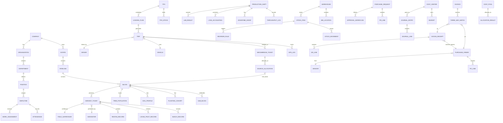

# System Design Document
## AI-Powered Integrated Palm Oil Plantation Management Information System

**Version:** 1.0 (Template)
**Date:** 2025-01-15
**Phase:** 3 — Domain Analysis & System Design
**Status:** Draft

---

## 1. Domain Analysis

### 1.1 Bounded Contexts (Domain-Driven Design)

Based on business domains (Phase 1) and functional requirements (Phase 2), we identify the following bounded contexts:

| Bounded Context | Core Domain | Supporting Domains | Key Entities | Ownership |
|-----------------|-------------|-------------------|--------------|-----------|
| **Master Data** | Corporate hierarchy, reference data | - | Company, Estate, Afdeling, Block, Employee, Vendor, Material, Warehouse, CostCenter | Platform Team |
| **Plantation Operations** | Agronomy, planting, nursery | Master Data | Block, PlantingCycle, FertilizationPlan, Application, PestMonitoring, SoilAnalysis | Plantation Team |
| **Harvest & Transport** | Harvest recording, logistics | Plantation Ops, Master Data | HarvestTicket, Harvester, TPH, Trip, Vehicle, Driver | Operations Team |
| **Mill Operations** | Weighbridge, processing, quality | Harvest & Transport | WeighbridgeTicket, ProductionShift, LabResult, MillInventory | Mill Team |
| **Inventory & Procurement** | Stock, purchasing, vendors | Master Data, Plantation Ops | StockItem, StockMovement, PurchaseRequest, PurchaseOrder, Vendor | Supply Chain Team |
| **Human Resources** | Attendance, payroll, K3 | Master Data | Employee, Attendance, WorkAssignment, Payroll, Incident | HR Team |
| **Finance & Accounting** | Cost accounting, GL, budget | All contexts | CostCenter, Budget, JournalEntry, CostAllocation, FinancialReport | Finance Team |
| **Sales & Contracts** | Customer, orders, shipping | Mill Ops, Inventory | Customer, SalesContract, SalesOrder, Delivery, Invoice | Sales Team |
| **Compliance & Sustainability** | ISPO, traceability, K3, risk | All contexts | Permit, Audit, TraceabilityLink, Risk, SustainabilityReport | Compliance Team |
| **Business Intelligence** | Dashboards, reports, KPIs | All contexts | Dashboard, Report, KPI, Alert, AIInsight | BI/AI Team |

### 1.2 Context Map (Integration Patterns)

```
┌─────────────────┐     ┌──────────────────┐     ┌─────────────────┐
│  Master Data    │────▶│ Plantation Ops   │────▶│ Harvest/Transport│
│  (Upstream)     │     │                  │     │                 │
└─────────────────┘     └────────┬─────────┘     └────────┬────────┘
                                 │                        │
                                 ▼                        ▼
                        ┌──────────────────┐     ┌─────────────────┐
                        │  Mill Operations │◀────│ Inventory/Proc  │
                        └────────┬─────────┘     └────────┬────────┘
                                 │                        │
                                 ▼                        ▼
                        ┌──────────────────┐     ┌─────────────────┐
                        │   Finance/Acc    │◀────│   HR/Payroll    │
                        └────────┬─────────┘     └─────────────────┘
                                 │
                                 ▼
                        ┌──────────────────┐
                        │  Sales/Contracts │
                        └────────┬─────────┘
                                 │
                                 ▼
                        ┌──────────────────┐
                        │ Compliance/Sust  │
                        └────────┬─────────┘
                                 │
                                 ▼
                        ┌──────────────────┐
                        │  BI & AI Layer   │ (Cross-cutting)
                        └──────────────────┘
```

**Integration Patterns:**
- **Master Data → All**: Published events (Kafka/Laravel Events), read replicas
- **Plantation → Harvest**: Direct API (same deployment), shared DB
- **Harvest → Mill**: Async events (Weighbridge sync), eventual consistency
- **All → Finance**: Event-driven cost/revenue posting, saga for distributed transactions
- **All → BI**: CDC (Change Data Capture) to data warehouse, real-time WebSocket for dashboards
- **AI Layer**: Reads from all contexts via read models, writes insights back via events

### 1.3 Aggregate Roots & Entities (Per Context)

#### Master Data Context
```
Company (AR)
├── Estate (AR)
│   ├── Afdeling (AR)
│   │   ├── Block (AR)
│   │   │   ├── SubBlock
│   │   │   ├── SoilProfile
│   │   │   ├── PlantingCohort
│   │   │   └── TreePopulation
│   │   └── Nursery
│   └── Warehouse
├── Organization (AR)
│   ├── Department
│   ├── Position
│   └── Employee (AR)
├── Vendor (AR)
├── Customer (AR)
├── Material (AR)
├── Equipment (AR)
├── Vehicle (AR)
├── CostCenter (AR)
└── Budget (AR)
```

#### Plantation Operations Context
```
Block (AR, shared)
├── PlantingCycle (AR)
│   ├── PlantingEvent
│   ├── Census
│   └── ReplantingPlan
├── FertilizationPlan (AR)
│   ├── FertilizerRecommendation
│   ├── WorkOrder
│   └── Application (AR)
│       ├── ActualRate
│       ├── Condition
│       └── Evidence
├── PestMonitoring (AR)
│   ├── ScoutingRoute
│   ├── TrapCount
│   └── ThresholdAlert
├── DiseaseMonitoring (AR)
│   ├── SymptomReport
│   ├── LabConfirmation
│   └── QuarantineAction
├── WeedControl (AR)
├── PruningRecord
├── DrainageMaintenance
└── FieldInspection (AR)
    ├── ChecklistResponse
    ├── Observation
    └── Verification
```

#### Harvest & Transport Context
```
HarvestSchedule (AR)
├── DailyAssignment
│   ├── HarvesterAssignment
│   └── GangAssignment
HarvestTicket (AR)
├── BunchRecord
├── LooseFruitRecord
├── RestanRecord
└── QualityGrade
TPH (AR)
├── TPHStock
└── LoadingPlan
Trip (AR)
├── GPSLog
├── WeighbridgeTicket
├── FuelRecord
└── DelayEvent
Vehicle (AR, shared)
├── MaintenanceSchedule
├── MaintenanceRecord
└── UtilizationLog
Driver (AR, shared)
├── Roster
├── License
└── MedicalCert
```

#### Mill Operations Context
```
WeighbridgeTicket (AR, shared)
├── GradeAssessment
├── SourceAllocation
└── Deduction
ProductionShift (AR)
├── ProcessParameter
├── ThroughputLog
├── DowntimeEvent
└── LossAccounting
LabResult (AR)
├── FFBSample
├── CPOSample
├── KernelSample
├── POMESample
└── SpecCheck
MillInventory (AR)
├── TankStock
├── DispatchRecord
└── Reconciliation
```

#### Inventory & Procurement Context
```
Warehouse (AR, shared)
├── BinLocation
├── StockItem (AR)
│   ├── StockLevel
│   ├── StockMovement
│   └── ReorderRule
├── GoodsReceipt (AR)
│   ├── GRLine
│   └── InspectionResult
├── GoodsIssue (AR)
│   └── GILine
├── StockTransfer (AR)
├── StockOpname (AR)
│   ├── OpnameLine
│   └── VarianceAdjustment
PurchaseRequest (AR)
├── PRLine
└── ApprovalWorkflow
PurchaseOrder (AR)
├── POLine
├── VendorAcknowledgement
└── DeliverySchedule
VendorScorecard (AR)
└── EvaluationCriteria
```

#### Finance Context
```
CostCenter (AR, shared)
├── Budget (AR)
│   ├── BudgetLine
│   └── Virement
JournalEntry (AR)
├── JournalLine
└── AllocationRule
CostPool (AR)
├── CostDriver
└── AllocationResult
FinancialReport (AR)
└── ReportLine
```

---

## 2. Database Design

### 2.1 ERD Overview (Key Tables)



### 2.2 Core Table Definitions (Sample)

#### companies
```sql
CREATE TABLE companies (
    id BIGINT UNSIGNED PRIMARY KEY AUTO_INCREMENT,
    uuid CHAR(36) NOT NULL UNIQUE,
    name VARCHAR(255) NOT NULL,
    legal_name VARCHAR(255),
    tax_id VARCHAR(50),
    address TEXT,
    phone VARCHAR(50),
    email VARCHAR(255),
    logo_path VARCHAR(500),
    settings JSON,
    is_active BOOLEAN DEFAULT TRUE,
    created_at TIMESTAMP DEFAULT CURRENT_TIMESTAMP,
    updated_at TIMESTAMP DEFAULT CURRENT_TIMESTAMP ON UPDATE CURRENT_TIMESTAMP,
    deleted_at TIMESTAMP NULL,
    INDEX idx_uuid (uuid),
    INDEX idx_active (is_active)
) ENGINE=InnoDB DEFAULT CHARSET=utf8mb4 COLLATE=utf8mb4_unicode_ci;
```

#### estates
```sql
CREATE TABLE estates (
    id BIGINT UNSIGNED PRIMARY KEY AUTO_INCREMENT,
    uuid CHAR(36) NOT NULL UNIQUE,
    company_id BIGINT UNSIGNED NOT NULL,
    code VARCHAR(20) NOT NULL,
    name VARCHAR(255) NOT NULL,
    location POINT NOT NULL, -- GIS centroid
    boundary POLYGON, -- GIS boundary
    total_area_ha DECIMAL(10,2),
    planted_area_ha DECIMAL(10,2),
    hgu_number VARCHAR(100),
    hgu_expiry DATE,
    manager_id BIGINT UNSIGNED,
    is_active BOOLEAN DEFAULT TRUE,
    created_at TIMESTAMP DEFAULT CURRENT_TIMESTAMP,
    updated_at TIMESTAMP DEFAULT CURRENT_TIMESTAMP ON UPDATE CURRENT_TIMESTAMP,
    deleted_at TIMESTAMP NULL,
    FOREIGN KEY (company_id) REFERENCES companies(id),
    FOREIGN KEY (manager_id) REFERENCES employees(id),
    SPATIAL INDEX idx_boundary (boundary),
    INDEX idx_company (company_id),
    UNIQUE KEY uk_company_code (company_id, code)
) ENGINE=InnoDB DEFAULT CHARSET=utf8mb4 COLLATE=utf8mb4_unicode_ci;
```

#### blocks
```sql
CREATE TABLE blocks (
    id BIGINT UNSIGNED PRIMARY KEY AUTO_INCREMENT,
    uuid CHAR(36) NOT NULL UNIQUE,
    afdeling_id BIGINT UNSIGNED NOT NULL,
    code VARCHAR(20) NOT NULL,
    name VARCHAR(255),
    variety_id BIGINT UNSIGNED,
    planting_year YEAR,
    planting_date DATE,
    spacing VARCHAR(20), -- e.g., "9x9x9"
    density_per_ha INT,
    total_palms INT,
    productive_palms INT,
    area_ha DECIMAL(10,2) NOT NULL,
    boundary POLYGON NOT NULL, -- GIS
    soil_type VARCHAR(100),
    terrain_type ENUM('flat', 'undulating', 'hilly', 'steep'),
    status ENUM('immature', 'mature', 'prime', 'declining', 'replanting', 'cleared') DEFAULT 'immature',
    replanting_due_year YEAR,
    created_at TIMESTAMP DEFAULT CURRENT_TIMESTAMP,
    updated_at TIMESTAMP DEFAULT CURRENT_TIMESTAMP ON UPDATE CURRENT_TIMESTAMP,
    deleted_at TIMESTAMP NULL,
    FOREIGN KEY (afdeling_id) REFERENCES afdelings(id),
    FOREIGN KEY (variety_id) REFERENCES palm_varieties(id),
    SPATIAL INDEX idx_boundary (boundary),
    INDEX idx_afdeling (afdeling_id),
    INDEX idx_status (status),
    UNIQUE KEY uk_afdeling_code (afdeling_id, code)
) ENGINE=InnoDB DEFAULT CHARSET=utf8mb4 COLLATE=utf8mb4_unicode_ci;
```

#### harvest_tickets
```sql
CREATE TABLE harvest_tickets (
    id BIGINT UNSIGNED PRIMARY KEY AUTO_INCREMENT,
    uuid CHAR(36) NOT NULL UNIQUE,
    ticket_number VARCHAR(50) NOT NULL,
    block_id BIGINT UNSIGNED NOT NULL,
    harvester_id BIGINT UNSIGNED NOT NULL,
    supervisor_id BIGINT UNSIGNED,
    harvest_date DATE NOT NULL,
    shift ENUM('morning', 'afternoon', 'night') DEFAULT 'morning',
    start_time TIMESTAMP,
    end_time TIMESTAMP,
    total_bunches INT DEFAULT 0,
    total_weight_kg DECIMAL(10,2) DEFAULT 0,
    loose_fruit_kg DECIMAL(10,2) DEFAULT 0,
    restan_bunches INT DEFAULT 0,
    restan_reason VARCHAR(100),
    quality_grade ENUM('A', 'B', 'C', 'D') DEFAULT 'B',
    productivity_ton_per_manday DECIMAL(6,3),
    status ENUM('draft', 'submitted', 'approved', 'rejected', 'synced') DEFAULT 'draft',
    gps_start_point POINT,
    gps_end_point POINT,
    evidence_photos JSON, -- array of paths
    notes TEXT,
    approved_at TIMESTAMP NULL,
    synced_at TIMESTAMP NULL,
    created_at TIMESTAMP DEFAULT CURRENT_TIMESTAMP,
    updated_at TIMESTAMP DEFAULT CURRENT_TIMESTAMP ON UPDATE CURRENT_TIMESTAMP,
    deleted_at TIMESTAMP NULL,
    FOREIGN KEY (block_id) REFERENCES blocks(id),
    FOREIGN KEY (harvester_id) REFERENCES employees(id),
    FOREIGN KEY (supervisor_id) REFERENCES employees(id),
    INDEX idx_block_date (block_id, harvest_date),
    INDEX idx_harvester_date (harvester_id, harvest_date),
    INDEX idx_status (status),
    INDEX idx_synced (synced_at),
    UNIQUE KEY uk_ticket_number (ticket_number)
) ENGINE=InnoDB DEFAULT CHARSET=utf8mb4 COLLATE=utf8mb4_unicode_ci;
```

#### weighbridge_tickets
```sql
CREATE TABLE weighbridge_tickets (
    id BIGINT UNSIGNED PRIMARY KEY AUTO_INCREMENT,
    uuid CHAR(36) NOT NULL UNIQUE,
    ticket_number VARCHAR(50) NOT NULL,
    trip_id BIGINT UNSIGNED,
    vehicle_id BIGINT UNSIGNED NOT NULL,
    driver_id BIGINT UNSIGNED,
    mill_id BIGINT UNSIGNED NOT NULL,
    gross_weight_kg DECIMAL(10,2) NOT NULL,
    tare_weight_kg DECIMAL(10,2) NOT NULL,
    net_weight_kg DECIMAL(10,2) NOT NULL,
    grade ENUM('A', 'B', 'C', 'D') DEFAULT 'B',
    deductions JSON, -- {brondolan: 50, long_stalk: 20, ...}
    ffb_source_allocations JSON, -- [{block_id, weight_kg, percentage}]
    weighed_at TIMESTAMP NOT NULL,
    weigher_id BIGINT UNSIGNED,
    status ENUM('draft', 'confirmed', 'cancelled') DEFAULT 'draft',
    created_at TIMESTAMP DEFAULT CURRENT_TIMESTAMP,
    updated_at TIMESTAMP DEFAULT CURRENT_TIMESTAMP ON UPDATE CURRENT_TIMESTAMP,
    FOREIGN KEY (trip_id) REFERENCES trips(id),
    FOREIGN KEY (vehicle_id) REFERENCES vehicles(id),
    FOREIGN KEY (driver_id) REFERENCES employees(id),
    FOREIGN KEY (mill_id) REFERENCES mills(id),
    FOREIGN KEY (weigher_id) REFERENCES employees(id),
    INDEX idx_mill_date (mill_id, weighed_at),
    INDEX idx_vehicle_date (vehicle_id, weighed_at),
    INDEX idx_trip (trip_id),
    UNIQUE KEY uk_ticket_number (ticket_number)
) ENGINE=InnoDB DEFAULT CHARSET=utf8mb4 COLLATE=utf8mb4_unicode_ci;
```

#### stock_items
```sql
CREATE TABLE stock_items (
    id BIGINT UNSIGNED PRIMARY KEY AUTO_INCREMENT,
    uuid CHAR(36) NOT NULL UNIQUE,
    warehouse_id BIGINT UNSIGNED NOT NULL,
    material_id BIGINT UNSIGNED NOT NULL,
    bin_location_id BIGINT UNSIGNED,
    batch_number VARCHAR(100),
    expiry_date DATE,
    quantity_on_hand DECIMAL(15,3) DEFAULT 0,
    quantity_reserved DECIMAL(15,3) DEFAULT 0,
    quantity_available DECIMAL(15,3) GENERATED ALWAYS AS (quantity_on_hand - quantity_reserved) STORED,
    unit_cost DECIMAL(15,4),
    valuation_method ENUM('FIFO', 'FEFO', 'WEIGHTED_AVG', 'STANDARD') DEFAULT 'FIFO',
    last_movement_at TIMESTAMP NULL,
    created_at TIMESTAMP DEFAULT CURRENT_TIMESTAMP,
    updated_at TIMESTAMP DEFAULT CURRENT_TIMESTAMP ON UPDATE CURRENT_TIMESTAMP,
    FOREIGN KEY (warehouse_id) REFERENCES warehouses(id),
    FOREIGN KEY (material_id) REFERENCES materials(id),
    FOREIGN KEY (bin_location_id) REFERENCES bin_locations(id),
    INDEX idx_warehouse_material (warehouse_id, material_id),
    INDEX idx_expiry (expiry_date),
    INDEX idx_batch (batch_number),
    UNIQUE KEY uk_warehouse_material_batch (warehouse_id, material_id, batch_number)
) ENGINE=InnoDB DEFAULT CHARSET=utf8mb4 COLLATE=utf8mb4_unicode_ci;
```

### 2.3 Migration Strategy

| Phase | Tables | Approach |
|-------|--------|----------|
| 1 | Master Data (companies, estates, afdelings, blocks, employees, materials, vendors, warehouses, cost_centers) | Fresh install + data import from cleaned Excel/CSV |
| 2 | Plantation Ops (planting_cohorts, soil_profiles, tree_populations, fertilization_plans, applications, pest_monitoring) | Fresh install, historical data via seeders |
| 3 | Harvest/Transport (harvest_tickets, trips, weighbridge_tickets, tph_stock) | Fresh install, parallel run 1 month |
| 4 | Mill (production_shifts, lab_results, mill_inventory) | Fresh install, parallel run 1 month |
| 5 | Inventory/Procurement (stock_items, movements, PR, PO, GR, invoices) | Fresh install, opening balance import |
| 6 | Finance/HR (journal_entries, budgets, attendance, payroll) | Fresh install, opening balance import |
| 7 | BI/AI (dashboards, KPIs, AI insights, knowledge_base) | Built on top, no migration |

**Data Migration Principles:**
- Cleanse before migrate (deduplicate, standardize codes, validate FK)
- Run parallel for 1-2 months with daily reconciliation
- Cutover on month-end for clean accounting periods
- Keep legacy read-only for 6 months

### 2.4 Indexing Strategy

| Table | Key Indexes | Purpose |
|-------|-------------|---------|
| blocks | SPATIAL(boundary), (afdeling_id, status), (variety_id, planting_year) | GIS queries, reporting filters |
| harvest_tickets | (block_id, harvest_date), (harvester_id, harvest_date), (status, synced_at) | Daily queries, sync tracking |
| weighbridge_tickets | (mill_id, weighed_at), (vehicle_id, weighed_at), (trip_id) | Mill reports, vehicle tracking |
| stock_items | (warehouse_id, material_id), (expiry_date), (batch_number) | Stock lookup, FEFO, traceability |
| stock_movements | (stock_item_id, created_at), (reference_type, reference_id) | Audit trail, drill-down |
| journal_entries | (cost_center_id, entry_date), (reference_type, reference_id) | Cost center reports, traceability |
| attendance | (employee_id, attendance_date), (shift, attendance_date) | Payroll, productivity |

---

## 3. System Architecture

### 3.1 High-Level Architecture (Modular Monolith)

```
┌─────────────────────────────────────────────────────────────────────────────┐
│                         LARAVEL MODULAR MONOLITH                            │
├─────────────────────────────────────────────────────────────────────────────┤
│                                                                             │
│  ┌──────────────┐  ┌──────────────┐  ┌──────────────┐  ┌──────────────┐   │
│  │   Web App    │  │  Mobile API  │  │  WebSocket   │  │  Scheduled   │   │
│  │  (Livewire)  │  │  (Sanctum)   │  │  (Reverb)    │  │  (Scheduler) │   │
│  └──────┬───────┘  └──────┬───────┘  └──────┬───────┘  └──────┬───────┘   │
│         │                 │                 │                 │            │
│         └─────────────────┼─────────────────┼─────────────────┘            │
│                           ▼                                                 │
│              ┌────────────────────────┐                                   │
│              │    Application Core    │                                   │
│              │  (Actions, Services,   │                                   │
│              │   Events, Listeners)   │                                   │
│              └───────────┬────────────┘                                   │
│                          │                                                │
│         ┌────────────────┼────────────────┐                              │
│         │                │                │                              │
│  ┌──────▼──────┐ ┌───────▼───────┐ ┌──────▼──────┐ ┌──────▼──────┐      │
│  │   Modules   │ │   Modules     │ │   Modules   │ │   Modules   │      │
│  │ (Plantation)│ │ (Harvest/     │ │ (Mill/      │ │ (Finance/   │      │
│  │             │ │  Transport)   │ │  Inventory) │ │  HR/Sales)  │      │
│  └──────┬──────┘ └───────┬───────┘ └──────┬──────┘ └──────┬──────┘      │
│         │                │                │                │              │
│         └────────────────┼────────────────┘                │              │
│                          ▼                                 │              │
│              ┌────────────────────────┐                   │              │
│              │   Shared Kernel        │                   │              │
│              │ (Master Data, Auth,    │                   │              │
│              │  Tenancy, Events)      │                   │              │
│              └───────────┬────────────┘                   │              │
│                          │                                 │              │
│         ┌────────────────┼────────────────┐               │              │
│         │                │                │               │              │
│  ┌──────▼──────┐ ┌───────▼───────┐ ┌──────▼──────┐ ┌──────▼──────┐      │
│  │  Database   │ │   Cache       │ │   Queue     │ │   Storage   │      │
│  │  (MySQL)    │ │  (Redis)      │ │  (Redis)    │ │  (S3/MinIO) │      │
│  └─────────────┘ └───────────────┘ └─────────────┘ └─────────────┘      │
│                                                                             │
└─────────────────────────────────────────────────────────────────────────────┘
```

### 3.2 Module Structure

```
app/
├── Modules/
│   ├── MasterData/
│   │   ├── Domain/
│   │   │   ├── Models/
│   │   │   ├── Events/
│   │   │   ├── Policies/
│   │   │   └── ValueObjects/
│   │   ├── Actions/
│   │   ├── Http/
│   │   │   ├── Controllers/
│   │   │   ├── Requests/
│   │   │   └── Resources/
│   │   ├── Livewire/
│   │   ├── Database/
│   │   │   ├── Migrations/
│   │   │   ├── Seeders/
│   │   │   └── Factories/
│   │   ├── Tests/
│   │   └── routes.php
│   ├── Plantation/
│   ├── HarvestTransport/
│   ├── Mill/
│   ├── InventoryProcurement/
│   ├── HumanResources/
│   ├── Finance/
│   ├── Sales/
│   ├── Compliance/
│   └── BusinessIntelligence/
├── Shared/
│   ├── Kernel/
│   │   ├── Tenancy/
│   │   ├── Events/
│   │   ├── Traits/
│   │   └── ValueObjects/
│   ├── Auth/
│   ├── UI/
│   └── Exceptions/
└── Console/
```

### 3.3 Module Communication Rules

| Rule | Description |
|------|-------------|
| **No direct model access** | Modules communicate via Actions/Services/Events only |
| **Shared Kernel** | Only MasterData models (Company, Estate, Employee, etc.) can be referenced directly |
| **Events for cross-module** | Use Laravel Events for async communication (e.g., HarvestCompleted → Mill receives) |
| **Actions for sync** | Use Action classes for synchronous operations needing return values |
| **DTOs for contracts** | Define Data Transfer Objects in Shared/Kernel for module interfaces |
| **Database per module** | Each module owns its tables; FKs to Shared Kernel only |

### 3.4 Technology Stack Decisions

| Layer | Technology | Version | Rationale |
|-------|------------|---------|-----------|
| Framework | Laravel | 11.x (LTS) | Mature, ecosystem, modular support |
| Frontend | Livewire 3 + Blade | 3.x | Server-driven, no SPA complexity |
| CSS | Tailwind CSS | 3.x | Utility-first, consistent design |
| JS | Alpine.js | 3.x | Lightweight interactivity |
| Database | MySQL | 8.4+ | Spatial (GIS), JSON, CTE, window functions |
| Cache/Queue | Redis | 7.x | High performance, pub/sub, streams |
| WebSocket | Laravel Reverb | 1.x | Native WebSocket, horizontal scaling |
| Search | Meilisearch | 1.x | Fast full-text, typo-tolerant |
| GIS | MySQL Spatial + Leaflet | - | Native spatial, open-source maps |
| AI/ML | Python microservice (FastAPI) | 3.11+ | Separate from PHP, GPU support |
| Vector DB | Qdrant / pgvector | - | RAG embeddings, similarity search |
| LLM | Ollama (local) / OpenAI API | - | Data privacy, cost control |
| Monitoring | Prometheus + Grafana | - | Industry standard |
| Logging | Laravel Telescope + Loki | - | Debug + centralized logs |
| CI/CD | GitLab CI / GitHub Actions | - | Integrated with repo |
| Container | Docker + Docker Compose | - | Consistent environments |

---

## 4. Authorization Design

### 4.1 RBAC Model

```
Role (Global)
├── Permissions (Global)
└── Data Scopes (Contextual)

Permission = Action + Resource
  Actions: view, create, update, delete, approve, export, print
  Resources: harvest_ticket, fertilization_plan, stock_item, etc.

Data Scope = Organization Hierarchy Filter
  Levels: Company → Estate → Afdeling → Block
  User assigned to: Company / Estate / Afdeling / Block
  Inheritance: Parent scope includes children
```

### 4.2 Role Definitions

| Role | Global Permissions | Data Scope | Typical User |
|------|-------------------|------------|--------------|
| **Super Admin** | All | All Companies | IT Admin |
| **Company Admin** | All within company | Company | GM, IT Manager |
| **Estate Manager** | Plantation, Harvest, Transport, Inventory (read), Reports | Estate | Estate Manager |
| **Afdeling Manager** | Harvest, Transport, Agronomy (limited), Reports | Afdeling | Afdeling Head |
| **Agronomist** | Plantation (full), Reports | Assigned Estates | Agronomist |
| **Field Supervisor** | Harvest (create), Agronomy (create), Attendance (create) | Assigned Blocks | Mandor |
| **Harvester** | Harvest (own only) | Own Assignments | Harvester |
| **Transport Manager** | Transport (full), Vehicle, Driver | Estate/Company | Transport Head |
| **Driver** | Trip (own), Vehicle (read) | Own Trips | Driver |
| **Mill Manager** | Mill (full), Inventory (mill), Reports | Mill | Mill Manager |
| **Weighbridge Operator** | Weighbridge (create), Grade (create) | Mill | Operator |
| **Lab Technician** | Lab Results (create), Specs (read) | Mill | Lab Tech |
| **Warehouse Keeper** | Inventory (full), GR/GI, Opname | Assigned Warehouses | Gudang Keeper |
| **Procurement Officer** | PR, PO, Vendor, 3-Way Match | Company | Procurement |
| **Finance Manager** | Finance (full), Budget, Reports | Company | Finance Manager |
| **Accountant** | Journal, AP, AR, Cost Accounting | Company | Accountant |
| **Sales Manager** | Sales, Contracts, Customer, Delivery | Company | Sales Manager |
| **Sustainability Officer** | Compliance, Traceability, ISPO, K3 | Company | Sustainability |
| **K3 Officer** | K3 Incidents, Inspections, Training | Company | K3 Officer |
| **Viewer** | Read-only (assigned modules) | Assigned Scope | Auditors, Directors |

### 4.3 Policy Examples (Laravel Policies)

```php
// HarvestTicketPolicy
class HarvestTicketPolicy
{
    public function view(User $user, HarvestTicket $ticket): bool
    {
        return $user->canAccessBlock($ticket->block_id);
    }

    public function create(User $user): bool
    {
        return $user->hasPermission('harvest_ticket.create')
            && $user->hasRole(['Field Supervisor', 'Harvester']);
    }

    public function update(User $user, HarvestTicket $ticket): bool
    {
        if ($ticket->status !== 'draft') return false;
        return $user->id === $ticket->harvester_id 
            || $user->hasRole('Field Supervisor') && $user->canAccessBlock($ticket->block_id);
    }

    public function approve(User $user, HarvestTicket $ticket): bool
    {
        return $user->hasRole('Field Supervisor') 
            && $user->canAccessBlock($ticket->block_id);
    }
}

// BlockPolicy (Data Scope)
class BlockPolicy
{
    public function view(User $user, Block $block): bool
    {
        return $user->canAccessBlock($block->id);
    }

    public function viewAny(User $user): bool
    {
        return $user->hasPermission('block.view');
    }
}
```

### 4.4 Data Scope Implementation

```php
// Trait for User model
trait HasDataScope
{
    public function canAccessBlock(int $blockId): bool
    {
        if ($this->hasRole('Super Admin')) return true;
        
        $accessibleBlockIds = $this->accessibleBlockIds();
        return in_array($blockId, $accessibleBlockIds);
    }

    public function accessibleBlockIds(): array
    {
        return match ($this->data_scope_level) {
            'company' => Block::whereHas('afdeling.estate.company', fn($q) => 
                $q->where('id', $this->company_id))->pluck('id')->toArray(),
            'estate' => Block::whereHas('afdeling.estate', fn($q) => 
                $q->where('id', $this->estate_id))->pluck('id')->toArray(),
            'afdeling' => Block::where('afdeling_id', $this->afdeling_id)->pluck('id')->toArray(),
            'block' => [$this->block_id],
            default => [],
        };
    }

    public function scopeWithDataScope(Builder $query, string $relation = 'block'): Builder
    {
        if ($this->hasRole('Super Admin')) return $query;
        
        $blockIds = $this->accessibleBlockIds();
        return $query->whereHas($relation, fn($q) => $q->whereIn('id', $blockIds));
    }
}
```

---

## 5. API Design

### 5.1 RESTful Conventions

| Resource | Endpoint | Methods | Description |
|----------|----------|---------|-------------|
| Blocks | `/api/v1/blocks` | GET, POST | List/create blocks |
| Blocks | `/api/v1/blocks/{id}` | GET, PUT, PATCH, DELETE | Single block |
| Blocks | `/api/v1/blocks/{id}/harvest-tickets` | GET, POST | Nested harvest tickets |
| Harvest Tickets | `/api/v1/harvest-tickets` | GET, POST | List/create (with filters) |
| Harvest Tickets | `/api/v1/harvest-tickets/{id}` | GET, PUT, PATCH | Single ticket |
| Harvest Tickets | `/api/v1/harvest-tickets/{id}/approve` | POST | Approve action |
| Trips | `/api/v1/trips` | GET, POST | Transport trips |
| Trips | `/api/v1/trips/{id}/gps` | POST | GPS batch upload |
| Weighbridge | `/api/v1/weighbridge/tickets` | GET, POST | Weighbridge tickets |
| Stock | `/api/v1/stock/items` | GET | Stock levels |
| Stock | `/api/v1/stock/movements` | GET, POST | Stock movements |
| KPIs | `/api/v1/kpis/{code}/values` | GET | KPI time-series |
| AI | `/api/v1/ai/ask` | POST | Contextual question |
| AI | `/api/v1/ai/insights` | GET | Proactive insights |

### 5.2 Request/Response Standards

**Success Response:**
```json
{
  "success": true,
  "data": { ... },
  "meta": {
    "pagination": { "current_page": 1, "per_page": 20, "total": 100 },
    "timestamp": "2025-01-15T10:30:00Z"
  }
}
```

**Error Response:**
```json
{
  "success": false,
  "error": {
    "code": "VALIDATION_ERROR",
    "message": "The given data was invalid.",
    "details": { "field": ["error message"] }
  },
  "meta": { "timestamp": "2025-01-15T10:30:00Z", "trace_id": "abc123" }
}
```

### 5.3 Mobile-Specific Endpoints (Offline-First)

| Endpoint | Purpose | Sync Strategy |
|----------|---------|---------------|
| `POST /api/v1/mobile/sync` | Push local changes, pull server changes | Conflict resolution: server wins for master data, merge for transactional |
| `GET /api/v1/mobile/manifest` | Get sync manifest (checksums, versions) | Client compares, requests deltas |
| `POST /api/v1/mobile/harvest-tickets/batch` | Batch submit offline tickets | Atomic per ticket, partial success |
| `GET /api/v1/mobile/master-data/delta` | Incremental master data sync | Since last sync timestamp |

### 5.4 WebSocket Channels (Real-time)

| Channel | Events | Subscribers |
|---------|--------|-------------|
| `estate.{estateId}.dashboard` | KPI updates, alerts | Estate Manager, GM |
| `block.{blockId}.harvest` | New ticket, restan alert | Field Supervisor, Agronomist |
| `tph.{tphId}.stock` | Loading, dispatch | Transport Manager |
| `mill.{millId}.production` | OER/KER, downtime | Mill Manager |
| `warehouse.{warehouseId}.stock` | Min-stock alert, GR/GI | Warehouse Keeper |
| `user.{userId}.notifications` | Personal alerts | All users |
| `ai.insights.{estateId}` | Proactive AI insights | Managers |

---

## 6. AI Architecture

### 6.1 AI Processing Pipeline

```
┌─────────────┐    ┌─────────────┐    ┌─────────────┐    ┌─────────────┐
│   Data      │───▶│  Validation │───▶│  Business   │───▶│   KPI       │
│ Collection  │    │  & Quality  │    │   Rules     │    │   Engine    │
└─────────────┘    └─────────────┘    └─────────────┘    └──────┬──────┘
                                                                 │
                                                                 ▼
┌─────────────┐    ┌─────────────┐    ┌─────────────┐    ┌─────────────┐
│  Feedback   │◀───│  Insight    │◀───│  LLM        │◀───│  Context    │
│  & Eval     │    │  Storage    │    │  Analysis   │    │  Builder    │
└─────────────┘    └─────────────┘    └─────────────┘    └──────┬──────┘
                                                                 │
                          ┌─────────────┐                        │
                          │  Knowledge  │◀───────────────────────┘
                          │  Retrieval  │
                          │    (RAG)    │
                          └─────────────┘
```

### 6.2 Components

| Component | Technology | Responsibility |
|-----------|------------|----------------|
| **Data Collector** | Laravel Jobs + CDC | Pull operational data from all modules |
| **Validator** | PHP Rules + Custom | Schema, range, referential integrity checks |
| **Business Rules Engine** | PHP (deterministic) | Thresholds, calculations, compliance rules |
| **KPI Engine** | PHP + Materialized Views | Real-time KPI computation, caching |
| **Anomaly Detector** | PHP (statistical) + Python (ML) | Z-score, trend deviation, pattern matching |
| **Context Builder** | Laravel Service | Assemble relevant data per user query/context |
| **RAG Retriever** | Python (FastAPI) + Qdrant | Vector search over knowledge base |
| **LLM Analyzer** | Ollama (Llama 3.1) / OpenAI | Root cause, recommendation, explanation |
| **Guardrails** | Python + PHP | Hallucination check, citation validation, scope enforcement |
| **Insight Store** | MySQL + Elasticsearch | Persist insights, feedback, audit trail |
| **Evaluation Framework** | Python (RAGAS, custom) | Groundedness, faithfulness, relevance metrics |

### 6.3 Knowledge Base Structure

```
knowledge_base/
├── sops/
│   ├── plantation/
│   │   ├── fertilization_sop.md
│   │   ├── pest_control_sop.md
│   │   └── harvest_sop.md
│   ├── mill/
│   │   ├── startup_shutdown_sop.md
│   │   └── quality_control_sop.md
│   └── safety/
│       ├── k3_sop.md
│       └── emergency_response_sop.md
├── manuals/
│   ├── agronomy_manual.pdf
│   ├── mill_operation_manual.pdf
│   └── equipment_manuals/
├── references/
│   ├── ispo_standards.md
│   ├── rspo_principles.md
│   └── government_regulations.md
├── historical_cases/
│   ├── case_001_yield_drop_block_a05.md
│   └── case_002_rendement_loss_mill_2.md
└── best_practices/
    ├── fertilizer_optimization.md
    └── harvest_loss_reduction.md
```

**Ingestion Pipeline:**
1. Document upload → Parse (PDF/MD/HTML) → Clean → Chunk (500 tokens, 50 overlap)
2. Embed (bge-m3 / text-embedding-3-small) → Store in Qdrant with metadata
3. Metadata: source, version, domain, tags, access_level, effective_date
4. Versioning: New version creates new chunks, old marked deprecated
5. Access control: Filter by user's data scope at retrieval time

### 6.4 AI Guardrails

| Guardrail | Implementation | Threshold |
|-----------|----------------|-----------|
| **Citation Required** | Every claim must have source chunk | 100% |
| **Hallucination Check** | Cross-reference with deterministic data | Flag if mismatch |
| **Scope Enforcement** | Filter retrieval by user's data scope | Strict |
| **Confidence Calibration** | LLM outputs confidence 0-1 | Reject if < 0.6 |
| **PII Protection** | Strip personal data before LLM | Automatic |
| **Action Restriction** | No transactional commands (delete, approve, pay) | Hard block |
| **Rate Limiting** | Per user, per minute | 10 req/min |
| **Audit Logging** | Full prompt, context, response, feedback | Immutable |

---

## 7. Architecture Decision Records (ADRs)

### ADR-001: Modular Monolith over Microservices
**Status:** Accepted  
**Date:** 2025-01-15  
**Context:** Need to balance modularity with operational simplicity for a team of 5-8 developers.  
**Decision:** Use Laravel modular monolith with clear module boundaries, shared kernel, and event-driven communication.  
**Consequences:** 
- ✅ Single deployment, simpler DevOps
- ✅ Strong consistency within module, eventual across modules
- ✅ Can extract to microservices later if needed
- ❌ Requires discipline to maintain boundaries
- ❌ All modules share database (mitigated by FK discipline)

### ADR-002: MySQL 8.4 for Spatial + JSON + Analytics
**Status:** Accepted  
**Date:** 2025-01-15  
**Context:** Need GIS (block boundaries), flexible attributes (JSON), and analytical queries (CTE, window functions).  
**Decision:** Standardize on MySQL 8.4+ with InnoDB, spatial indexes, and generated columns.  
**Consequences:**
- ✅ Native GIS, no PostGIS dependency
- ✅ JSON for flexible attributes (evidence, allocations)
- ✅ Team familiarity
- ❌ Less advanced analytics than ClickHouse (mitigated by materialized views)

### ADR-003: Livewire 3 over React/Vue SPA
**Status:** Accepted  
**Date:** 2025-01-15  
**Context:** Team is PHP-centric; need fast development, SEO, offline mobile support.  
**Decision:** Livewire 3 + Blade + Alpine.js for web; separate mobile API for offline-first app.  
**Consequences:**
- ✅ Single codebase, no API duplication for web
- ✅ Server-side rendering, fast initial load
- ❌ Less rich interactivity than SPA (mitigated by Alpine.js)
- ❌ Mobile app needs separate API (planned)

### ADR-004: Redis for Cache, Queue, and WebSocket
**Status:** Accepted  
**Date:** 2025-01-15  
**Context:** Need high-performance caching, reliable queues, and real-time WebSocket.  
**Decision:** Single Redis cluster for all three; use Redis Streams for queues, Reverb for WebSocket.  
**Consequences:**
- ✅ Operational simplicity
- ✅ Pub/sub for real-time events
- ❌ Single point of failure (mitigated by Redis Sentinel/Cluster)

### ADR-005: Python Microservice for AI/ML
**Status:** Accepted  
**Date:** 2025-01-15  
**Context:** AI/ML ecosystem is Python-centric; PHP lacks mature ML libraries.  
**Decision:** Separate FastAPI service for RAG, embeddings, LLM orchestration; communicate via HTTP/gRPC.  
**Consequences:**
- ✅ Access to PyTorch, LangChain, LlamaIndex, transformers
- ✅ GPU utilization for embeddings/LLM
- ❌ Additional service to deploy/monitor
- ❌ Cross-language communication overhead

### ADR-006: Offline-First Mobile with Eventual Sync
**Status:** Accepted  
**Date:** 2025-01-15  
**Context:** Estates have poor/intermittent connectivity; field staff need full functionality offline.  
**Decision:** Local SQLite on mobile; sync engine with conflict resolution (server-wins for master, merge for transactional).  
**Consequences:**
- ✅ Uninterrupted field operations
- ✅ Data integrity via sync protocol
- ❌ Complex conflict resolution logic
- ❌ Larger mobile app bundle

### ADR-007: Deterministic KPI Engine + AI for Explanation
**Status:** Accepted  
**Date:** 2025-01-15  
**Context:** KPI calculations must be 100% accurate and auditable; AI for interpretation only.  
**Decision:** All KPIs computed in PHP/MySQL (deterministic); AI only explains deviations, suggests root causes.  
**Consequences:**
- ✅ Auditability, reproducibility
- ✅ No hallucination in numbers
- ❌ AI cannot "calculate" (by design)

### ADR-008: Multi-Tenancy via Company ID (Not Package)
**Status:** Accepted  
**Date:** 2025-01-15  
**Context:** System may serve multiple companies (holding structure) or single company with strict isolation.  
**Decision:** Implement company_id on all tables; global scopes for automatic filtering; no stancl/tenancy package.  
**Consequences:**
- ✅ Full control, no package dependency
- ✅ Works with shared database
- ❌ Must remember to apply scopes everywhere (enforced by base model)

---

## 8. Deployment Architecture

```
┌─────────────────────────────────────────────────────────────────────────────┐
│                           PRODUCTION ENVIRONMENT                            │
├─────────────────────────────────────────────────────────────────────────────┤
│                                                                             │
│  ┌──────────────┐     ┌──────────────┐     ┌──────────────┐               │
│  │  Load        │     │  Load        │     │  Load        │               │
│  │  Balancer    │     │  Balancer    │     │  Balancer    │               │
│  │  (Nginx)     │     │  (Nginx)     │     │  (Nginx)     │               │
│  └──────┬───────┘     └──────┬───────┘     └──────┬───────┘               │
│         │                    │                    │                        │
│  ┌──────▼───────┐     ┌──────▼───────┐     ┌──────▼───────┐               │
│  │  App Server  │     │  App Server  │     │  App Server  │  (Auto-scale) │
│  │  (PHP-FPM)   │     │  (PHP-FPM)   │     │  (PHP-FPM)   │               │
│  └──────┬───────┘     └──────┬───────┘     └──────┬───────┘               │
│         │                    │                    │                        │
│         └────────────────────┼────────────────────┘                        │
│                              │                                             │
│         ┌────────────────────┼────────────────────┐                        │
│         │                    │                    │                        │
│  ┌──────▼───────┐     ┌──────▼───────┐     ┌──────▼───────┐               │
│  │  MySQL       │     │  Redis       │     │  Meilisearch │               │
│  │  Primary     │     │  Cluster     │     │  Cluster     │               │
│  │  (Writer)    │     │  (Cache/Queue)│    │  (Search)    │               │
│  └──────┬───────┘     └──────────────┘     └──────────────┘               │
│         │                                             │                    │
│  ┌──────▼───────┐                                    │                    │
│  │  MySQL       │                                    │                    │
│  │  Replicas    │                                    │                    │
│  │  (Readers)   │                                    │                    │
│  └──────────────┘                                    │                    │
│                                                      │                    │
│  ┌──────────────────────────────────────────────────▼──────────────┐      │
│  │                    AI Service (Separate VPC)                    │      │
│  │  ┌──────────┐  ┌──────────┐  ┌──────────┐  ┌──────────┐       │      │
│  │  │ FastAPI  │  │  Qdrant  │  │  Ollama  │  │  MinIO   │       │      │
│  │  │  (API)   │  │ (Vector) │  │  (LLM)   │  │ (Models) │       │      │
│  │  └──────────┘  └──────────┘  └──────────┘  └──────────┘       │      │
│  └────────────────────────────────────────────────────────────────┘      │
│                                                                             │
│  ┌─────────────────────────────────────────────────────────────────────┐  │
│  │                    Observability Stack                              │  │
│  │  Prometheus + Grafana + Loki + Tempo + Alertmanager                │  │
│  └─────────────────────────────────────────────────────────────────────┘  │
│                                                                             │
└─────────────────────────────────────────────────────────────────────────────┘
```

---

## 9. Acceptance Criteria for Phase 3

| Criteria | Description | Verification |
|----------|-------------|--------------|
| AC-3.1 | Bounded contexts defined with clear ownership | Context map review |
| AC-3.2 | Aggregate roots and entities identified per context | Domain model review |
| AC-3.3 | ERD covers all 14 modules with FK relationships | ERD review with DBA |
| AC-3.4 | Migration strategy defined with parallel run plan | Migration doc review |
| AC-3.5 | Module structure follows communication rules | Code structure audit |
| AC-3.6 | RBAC matrix covers all 18 roles with data scopes | Policy test coverage |
| AC-3.7 | API spec (OpenAPI 3.1) complete for all endpoints | Spec validation |
| AC-3.8 | AI pipeline architecture with guardrails documented | Architecture review |
| AC-3.9 | ADRs recorded for all key decisions | ADR log review |
| AC-3.10 | Deployment architecture supports HA and scaling | Infra review |

---

## 10. Next Steps (Phase 4 Preview)

1. **UI/UX Design** - User flows, wireframes, design system, responsive specs
2. **Design System** - Color, typography, components, dark mode, RTL
3. **Prototyping** - Key screens in Figma, usability testing
4. **Accessibility** - WCAG 2.1 AA compliance plan

---

## 11. Approval

| Role | Name | Signature | Date |
|------|------|-----------|------|
| Technical Lead / Architect | | | |
| Domain Architect - Plantation | | | |
| Domain Architect - Mill | | | |
| Database Administrator | | | |
| Security Engineer | | | |
| AI Engineer | | | |
| Project Manager | | | |

---

*Document Version: 1.0 | Phase 3 - Domain Analysis & System Design*
*Generated as part of AI-Powered Integrated Palm Oil Plantation MIS Project*